# AdGuard Home: Network-Wide DNS Filtering on Proxmox (LXC)

[← Back to lab overview](../README.md) · [← Previous: Tailscale](../01-tailscale/)

Part of my **Home SOC Lab v2** rebuild. AdGuard Home is a self-hosted DNS
server that blocks ads, trackers and known-malicious domains for **every
device on the network at once**, with no client software needed. In a
security lab it does double duty: it's a privacy/ad-block layer *and* a DNS
telemetry source (every lookup on the network, logged and queryable).

> **Where it fits:** AdGuard runs as an LXC on the home LAN
> (`192.168.50.0/24`). Later, the Active Directory DC will become the lab's
> primary DNS and forward *up* to AdGuard. AdGuard stays the filtering
> brain while the DC handles `faid.lab` internally.

**What this shows:** DNS fundamentals · encrypted DNS (DoH) · Proxmox
helper-script deployment · least-privilege container settings · reading
dashboard data critically

---

## Goal

| Item | Value |
|---|---|
| Container | Unprivileged LXC, Debian 13 |
| CT ID / hostname | `101` / `adguard` |
| Resources | 1 vCPU · 512 MB RAM · 2 GB disk |
| Network | `vmbr0`, static **192.168.50.101/24**, gw 192.168.50.1 |
| Admin UI | `http://192.168.50.101` (port 80) |
| DNS service | port 53, all interfaces |
| Upstreams | Quad9 + Cloudflare over **DoH** (encrypted) |
| Blocklists | AdGuard DNS filter + AdGuard DNS Popup Hosts filter + OISD Big |
| AdGuard Home | v0.107.79 |

---

## Part 1: Deploy the container (Community Helper Script)

Unlike the Tailscale CT, which I built by hand, I used the Proxmox VE
Community Helper Script for AdGuard. It builds the LXC and installs AdGuard
in one step.

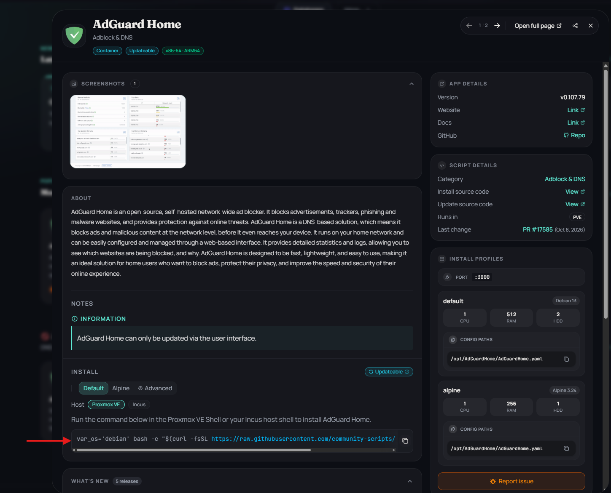

Run the install command from the **Proxmox host shell** (not inside a
container):

```bash
var_os='debian' bash -c "$(curl -fsSL https://raw.githubusercontent.com/community-scripts/ProxmoxVE/main/ct/adguard.sh)"
```

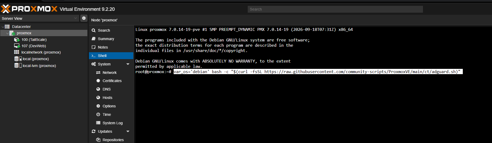

> **Trust check:** this pipes a script from the internet into `bash` as root
> on the hypervisor. The community-scripts project is open source and widely
> used, and its page links the install source code. Reading the script
> before running it is a good habit for anything that runs as root.

I chose **Advanced Install** so I could pin a static IP and control every
setting (rather than accept DHCP defaults).

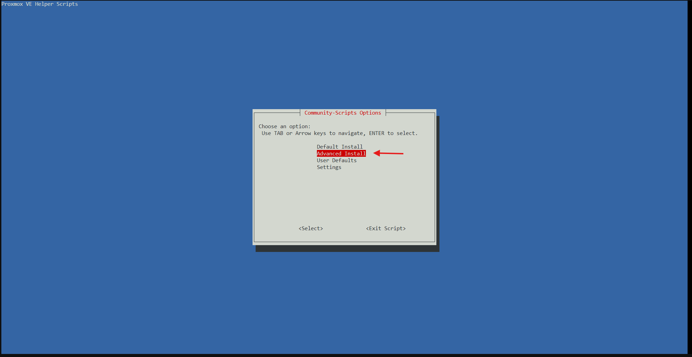

Key choices through the wizard:

| Setting | Value | Why |
|---|---|---|
| Container type | **Unprivileged** | least privilege, the default for anything security-facing |
| CT ID | `101` | next free ID after the Tailscale CT (100) |
| Hostname | `adguard` | clear, matches its role |
| Bridge | `vmbr0` (home LAN) | AdGuard serves the whole house, so it lives on the main LAN, not behind the firewall segments |
| IPv4 | **static** `192.168.50.101/24` | a DNS server's IP must never move |
| Gateway | `192.168.50.1` | my home router |

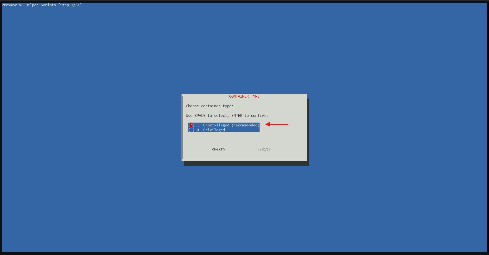
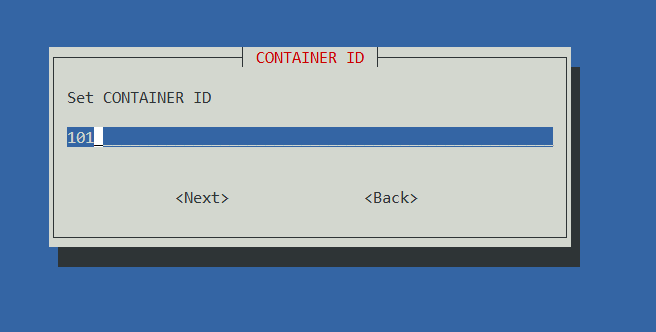
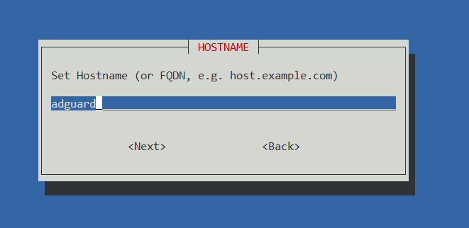

The bridge list already shows the segmented networks planned for later
phases (CORP, DMZ, SEC, ATTACK). AdGuard goes on `vmbr0`, the main LAN.

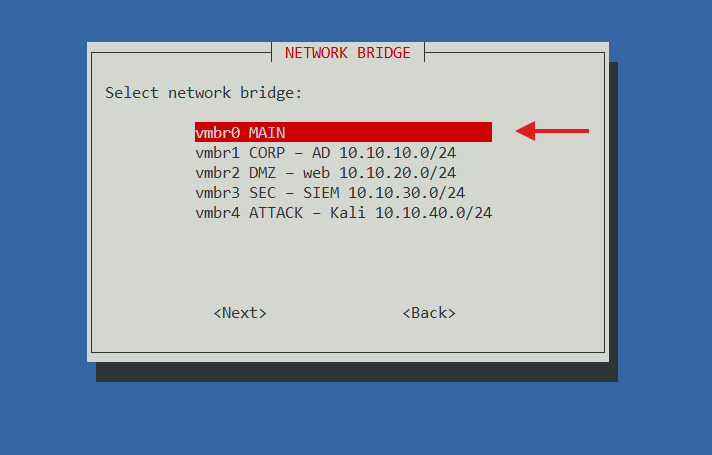
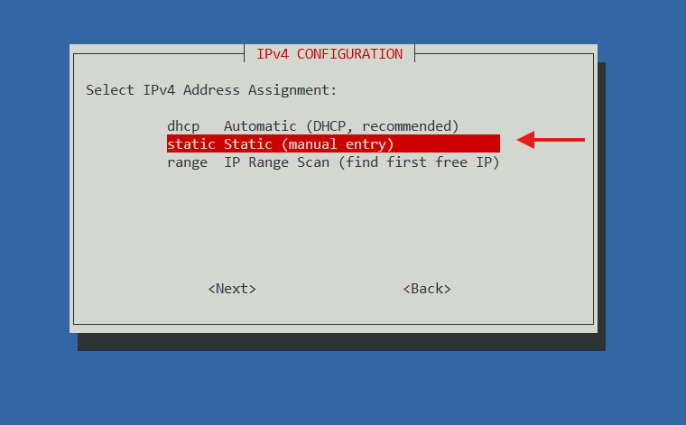
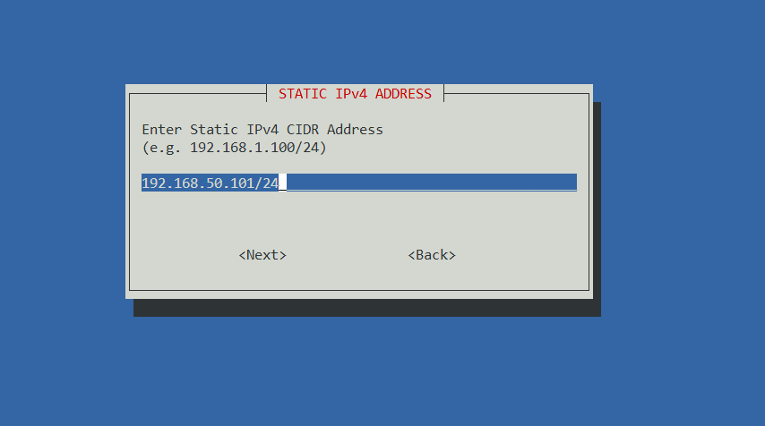
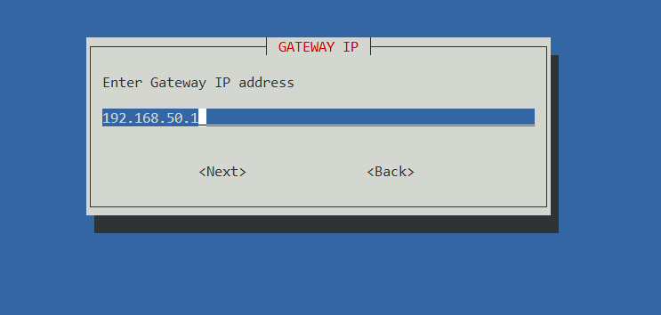

### Decision worth noting: TUN/TAP → No

The wizard asks whether to enable TUN/TAP. The **Tailscale** container needed
the TUN device (a VPN/subnet router can't work without it). AdGuard is just a
DNS server with no tunneling to do, so here the answer is **No**. Granting a
container a capability it doesn't use is needless attack surface. Least
privilege means saying no by default.

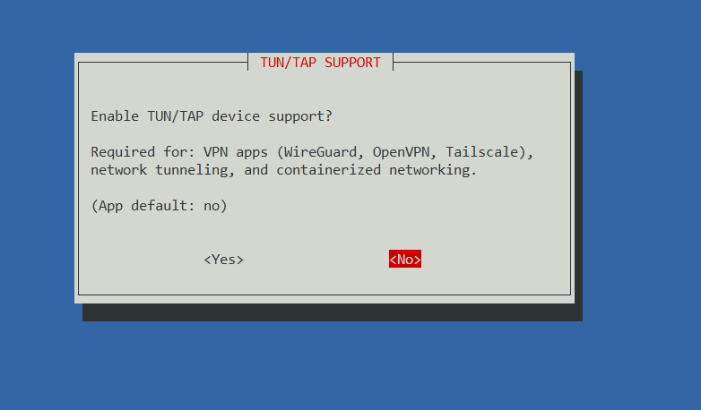

The advanced-install summary confirms the full config before build:

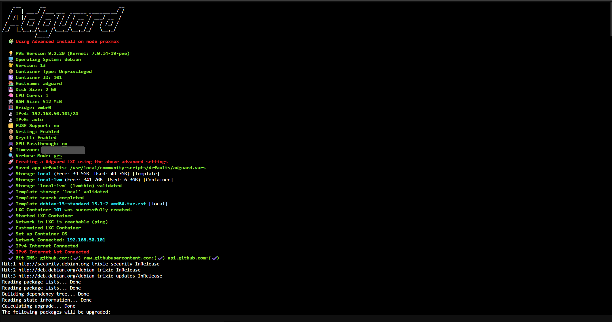

> **Harmless warning:** the summary shows **IPv6 Internet: Not Connected**.
> My network has no IPv6 internet connectivity, so that's expected. AdGuard
> runs fine on IPv4 alone. Not an error.

Build completes and prints the first-run URL (`http://192.168.50.101:3000`):

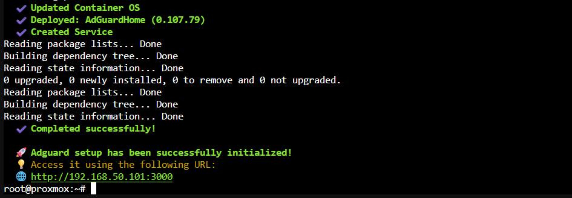

---

## Part 2: First-run setup wizard

Browse to the setup URL. **This wizard runs on port 3000, one time only.**

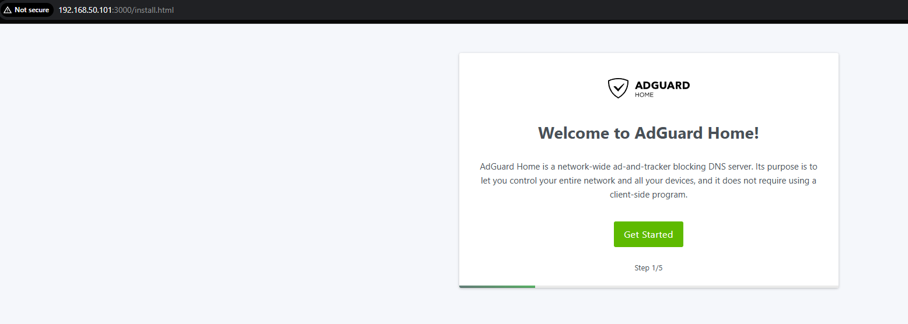

**Admin Web Interface + DNS server:** set the admin UI to **port 80** and the
DNS service to **port 53**, both on **All interfaces**.

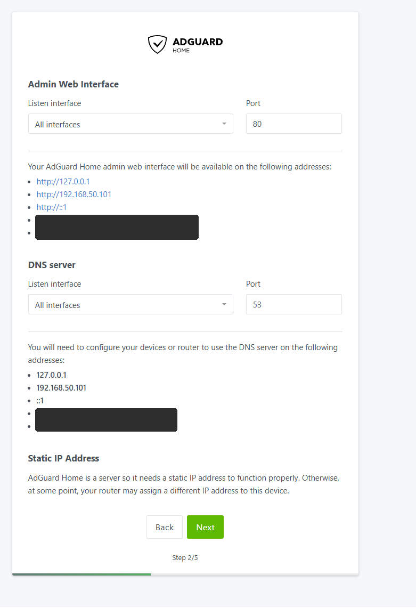

> **The port gotcha:** the setup wizard lives on **3000**, but I set the admin
> panel to **80** here. From now on the dashboard is just
> `http://192.168.50.101` (no `:3000`). Port **53** is standard DNS and stays
> as-is. Two different ports, two different jobs, no conflict.

Set an **admin username + password** (it goes into Vaultwarden later):

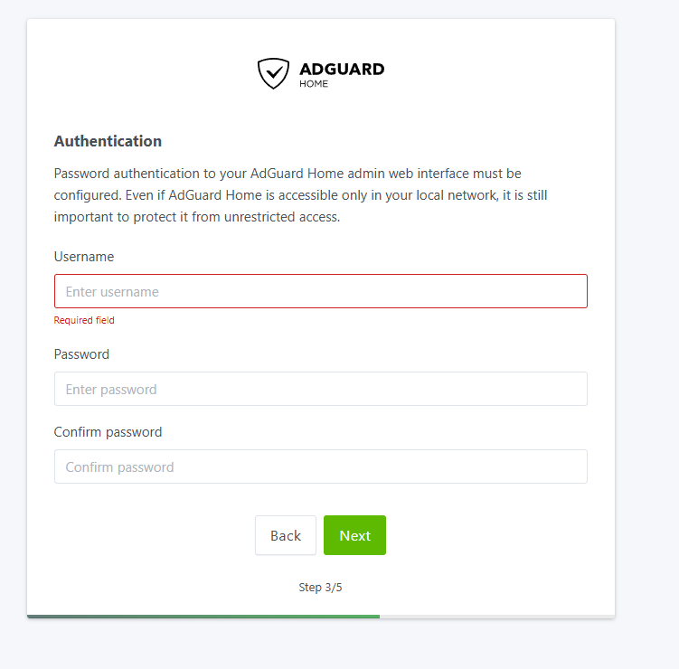

> **Known gap:** the admin panel is plain **HTTP**, so this login crosses the
> LAN unencrypted (the browser shows "Not secure"). It's acceptable on my own
> network for now. Nginx Proxy Manager, later in the build, will put the lab's
> web UIs behind HTTPS.

The wizard then shows how to point devices at AdGuard. I'm using the
**Router** method: my router hands out `192.168.50.101` as the DNS server via
DHCP, so every device on the network filters automatically with zero
per-device config.

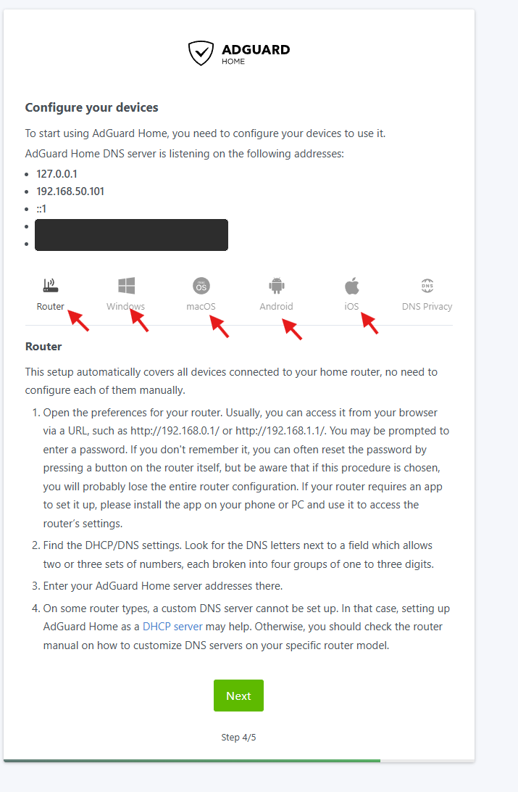

> **Note for later (DNS architecture):** router-level DHCP DNS is the quick way
> to go network-wide now. When the AD Domain Controller comes online, the DC
> becomes primary DNS (for `faid.lab`) and forwards up to AdGuard, and the
> router will point at the DC instead. Flagging it so I don't create a DNS loop
> at the AD phase.

---

## Part 3: Harden DNS: upstream choice

AdGuard forwards every lookup it doesn't block to an **upstream** resolver.
Out of the box, AdGuard Home already uses encrypted DNS-over-HTTPS (DoH) to
Quad9's `dns10` endpoint, which is Quad9's **unfiltered** service. I changed
it to two DoH upstreams I chose on purpose.

**Settings → DNS settings → Upstream DNS servers:**

```
https://dns.quad9.net/dns-query
https://dns.cloudflare.com/dns-query
```

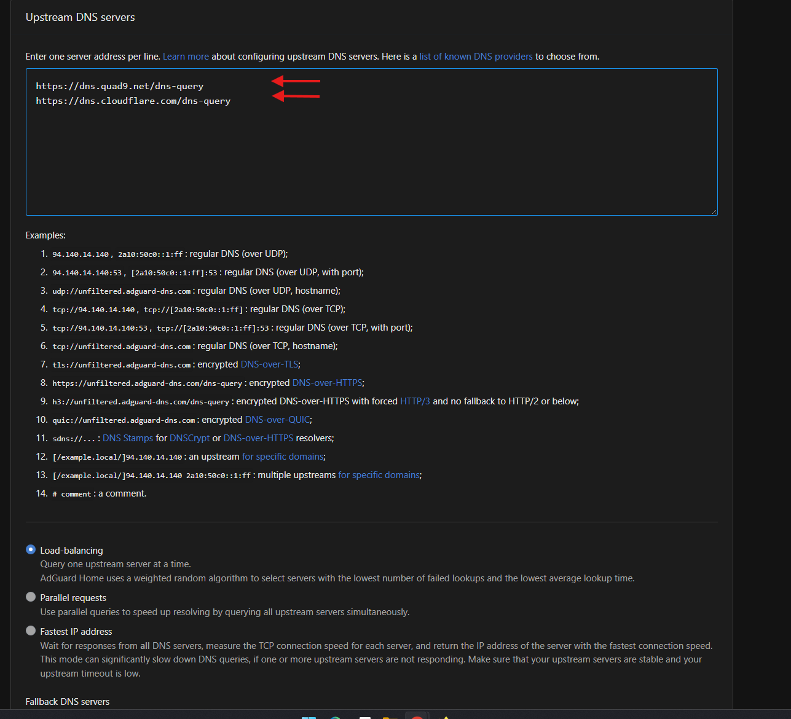

- **Quad9 (`dns.quad9.net`)** is the security-filtered service. It blocks
  known-malicious domains at the resolver, a second layer behind my
  blocklists, which fits a SOC lab.
- **Cloudflare** is the fast second upstream.

**What DoH does and doesn't hide:** it encrypts lookups between AdGuard and
the resolver, so the ISP can't read which domains the network looks up.
The ISP can still see which IP addresses I connect to. Lookups from devices
to AdGuard on the LAN are still plain DNS, which is fine inside my own
network.

**Load-balancing** mode queries one upstream at a time, weighted toward the
faster and healthier one:

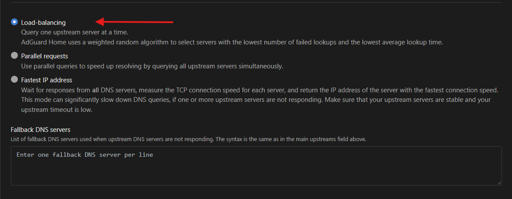

**Bootstrap DNS** (`9.9.9.9`, `1.1.1.1`) resolves the *hostnames* of those DoH
servers on first contact. It's a chicken-and-egg fix: you can't use DoH until
you've resolved the DoH server's own name.

The same page has **Private reverse DNS** pointed at the router
(`192.168.50.1`). That's why the dashboard later shows device names instead
of bare IPs. **Test upstreams → Apply.**

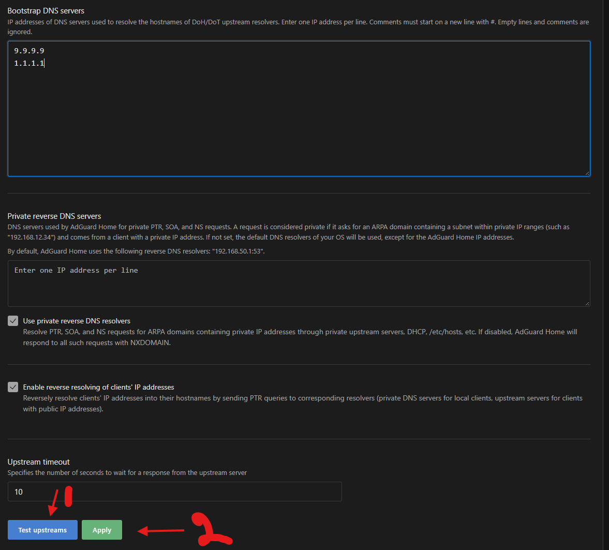

---

## Part 4: Blocklists

**Filters → DNS blocklists.** AdGuard ships with the *AdGuard DNS filter*
enabled (~179k rules). The *AdAway Default Blocklist* is also listed but
ships disabled, and I left it off.

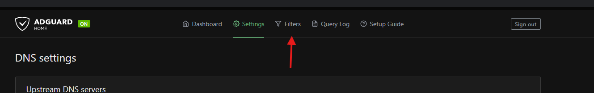
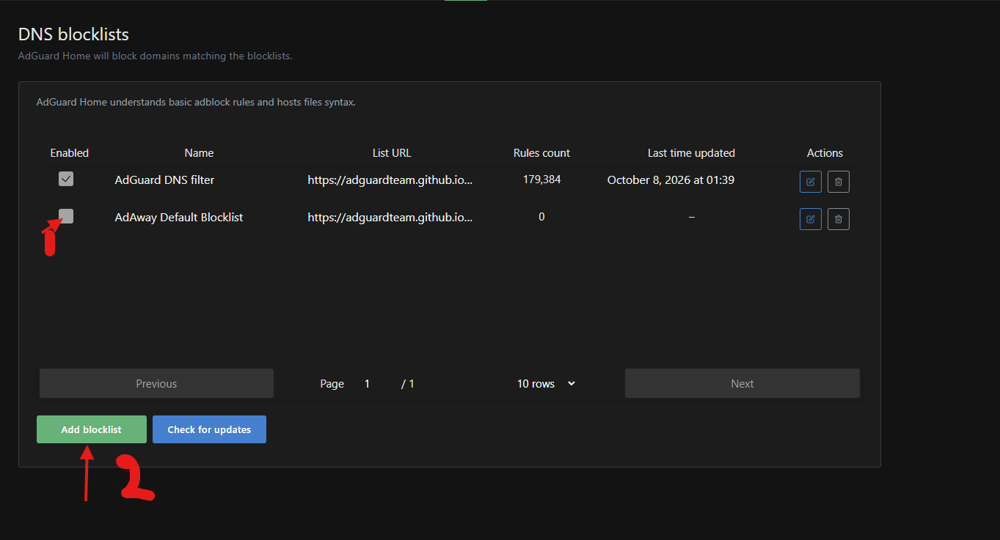

**Add blocklist → Choose from the list**, and I added two more:

- **AdGuard DNS Popup Hosts filter**: blocks domains that open pop-up and
  pop-under ads
- **OISD Blocklist Big**: a large, well-maintained general ads/trackers list

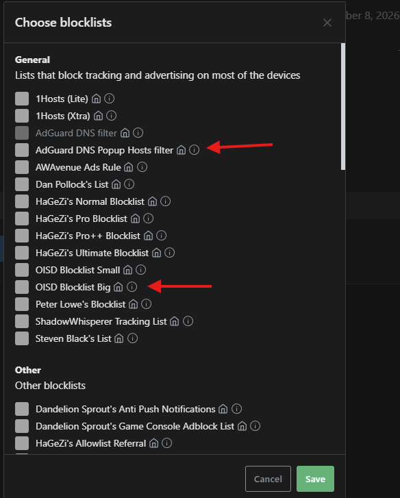

> **Why not 20 lists:** more lists mean more chance of false positives breaking
> a legit site, and diminishing returns on coverage. Three good, maintained
> lists beat a giant stack of overlapping ones.

---

## Part 5: Proof it works

I used an ad-block tester (**canyoublockit.com**) to generate known ad
traffic:

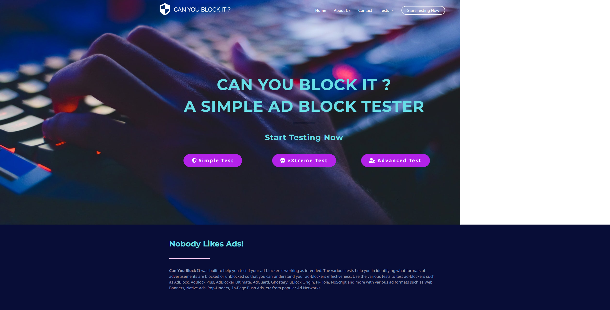

The dashboard is the real evidence:

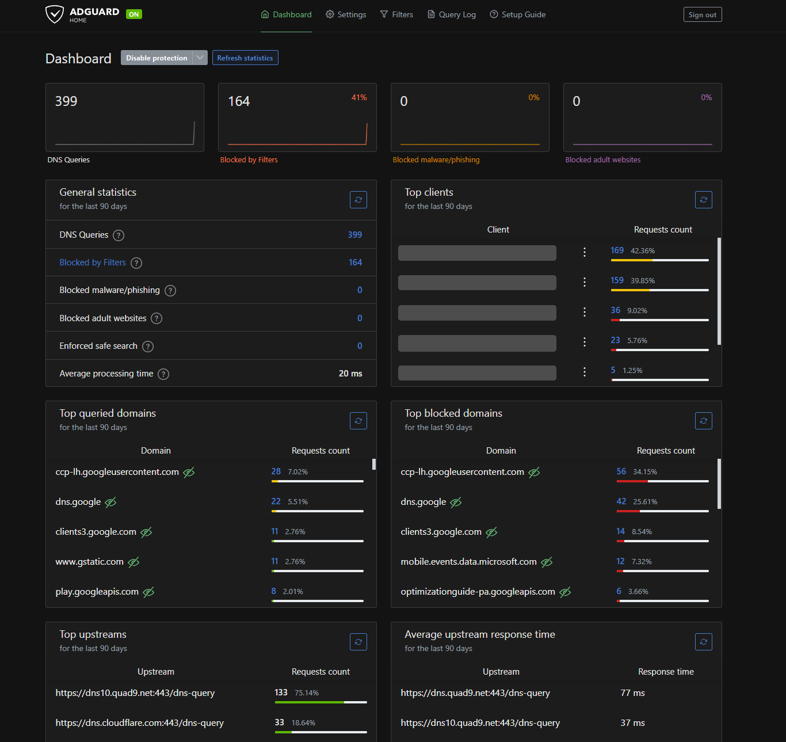

- **399 DNS queries · 164 blocked (41%) · 20 ms average processing time**
- Each client shows up by device name thanks to private reverse DNS
  (names and IPs redacted in the screenshot)
- Both upstream paths are DoH

### Reading the numbers critically

The headline figure needs context, the same way an alert does:

- **41% is mostly telemetry, not ads.** About 80% of the 164 blocks
  (130 of them) come from just five domains: Google and Microsoft background
  endpoints that retry constantly. It's also a small sample of 399 queries
  shortly after setup. Expect the percentage to settle lower over time.
- **One of those blocks is a win: `dns.google`.** That's Google's own encrypted
  DNS service. Blocking it stops devices from quietly bypassing AdGuard with
  their own DNS.
- **One to watch: `clients3.google.com`.** Android and Chrome use it for
  connectivity checks. If a device starts claiming "no internet" on working
  Wi-Fi, allowlisting this is the first thing to try.
- **The top upstream is still `dns10.quad9.net`,** the default I replaced.
  These stats cover 90 days, so they include queries from before the change.
  New queries go to `dns.quad9.net` and Cloudflare.

---

## Challenges & notes

### TUN/TAP: the opposite answer from last phase
Same question, different correct answer. Tailscale needed the TUN device;
AdGuard doesn't. The lesson: grant capabilities per service by what it
actually does, not by habit. Least privilege is a default, not an exception.

### Port 80 vs 3000
Setup runs on 3000; I moved the admin UI to 80 so the dashboard has a clean
URL. If you leave it on 3000 you'll keep typing `:3000` forever and wonder why
`http://192.168.50.101` doesn't load.

### IPv6 "Not Connected"
Shown in the install summary. Expected on a network with no IPv6 internet,
not a failure.

### Upstreams: defaults aren't always what you'd choose
The default upstream was already encrypted, but it was Quad9's *unfiltered*
service. Checking the default instead of assuming it is why I switched to
the malware-blocking endpoint.

### Single point of failure
With the router handing out only AdGuard's IP, if CT 101 goes down, the whole
house loses DNS. Two things keep that manageable: the CT should be set to
**start at boot** (CT → Options → Start at boot), and Uptime Kuma (next build)
will alert me if it stops responding. I'm deliberately *not* adding a public
resolver as the router's second DNS. Devices would use it at random and
skip filtering.

---

## Lessons learned

1. **One service, network-wide effect.** A single 512 MB container filters
   every device, which is the efficiency case for self-hosting DNS.
2. **DNS is telemetry.** The query log is a live feed of everything the network
   resolves, which is useful for spotting weird or malicious lookups later.
3. **Check the defaults.** AdGuard's default upstream was encrypted but
   unfiltered. Knowing *which* resolver you trust matters as much as
   encrypting the path to it.
4. **Question the headline number.** "41% blocked" was mostly five telemetry
   domains. Reading past the top-line stat is the same habit as triaging an
   alert.
5. **Least privilege, per service.** TUN/TAP yes for Tailscale, no for
   AdGuard. Decide by function, every time.

---

*Screenshots are redacted: client device names and IPs on the dashboard, the
container's IPv6 addresses (derived from its MAC) and the timezone are
covered, so nothing lists what's on my home network. AdGuard's own
`192.168.50.x` address is left visible. It's private (RFC 1918) and not
reachable from the internet. Image metadata is stripped.*

*Next in the build: Uptime Kuma (service monitoring), then Homepage
(dashboard), Nginx Proxy Manager + Vaultwarden, then OPNsense and the
segmented lab networks.*
