# Uptime Kuma: Service Monitoring & Alerting on Proxmox (LXC)

[← Back to lab overview](../README.md) · [← Previous: AdGuard Home](../02-adguard-home/)

Part of my **Home SOC Lab v2** rebuild. With remote access (Tailscale) and DNS
(AdGuard) running, the next question is: **how do I know when one of them
breaks?** Uptime Kuma answers that. It checks every service on a schedule and
sends an alert to my phone the moment something goes down.

---

## What Uptime Kuma does

Uptime Kuma is a free, open-source (MIT) monitoring tool with a web dashboard.
Every N seconds it runs a check against each service I tell it about:

- **HTTP(s):** does the web page answer, and with what status code?
- **Ping:** is the machine reachable on the network at all?
- **DNS:** does a DNS server actually return an answer?
- **TCP port, keyword, certificate expiry** and more for later phases

It records every check (up/down and response time). When a service changes
state, it sends a notification: **Telegram** in my case.

## Why it's worth running

| Benefit | What it means in practice |
|---|---|
| **Find out before anyone else does** | A down service alerts my phone in under a minute, instead of me noticing hours later when something doesn't load. In SOC terms, it shrinks *mean time to detect*. |
| **Alerts come to me** | Telegram push notifications mean I don't have to sit watching a dashboard. |
| **History and evidence** | Uptime % and response-time graphs answer "when did this start?" and "is it getting slower?" That's real data for troubleshooting instead of guessing. |
| **Covers AdGuard's single point of failure** | The whole house depends on AdGuard for DNS. Uptime Kuma is the safety net that tells me when it stops answering. |
| **Feeds the dashboard** | Its status page plugs into Homepage (next build), so the whole lab's health shows on one screen. |
| **Tiny footprint** | 1 vCPU, 1 GB RAM, 4 GB disk. |
| **Transferable skill** | Same idea as enterprise tools like Nagios, Zabbix, PRTG or Datadog: define checks, set thresholds, route alerts. It also covers the **Availability** part of the CIA triad. |

**What this shows:** monitoring design · alert routing · Proxmox helper-script
deployment · Linux upkeep · separating a monitor from what it monitors ·
least-privilege container settings

---

## Goal

| Item | Value |
|---|---|
| Container | Unprivileged LXC, Debian 13 |
| CT ID / hostname | `102` / `uptimekuma` |
| Resources | 1 vCPU · 1024 MB RAM · 4 GB disk (the script's default profile) |
| Network | `vmbr0`, static **192.168.50.102/24**, gateway `192.168.50.1` |
| DNS server | `9.9.9.9` (Quad9), deliberately **not** AdGuard (see below) |
| Web UI | `http://192.168.50.102:3001` |
| Uptime Kuma | v2.5.8, SQLite database |
| Monitors | 4: Proxmox, AdGuard web, AdGuard DNS, Tailscale |
| Alerts | Telegram bot, tested end-to-end with a real outage |

---

## Part 1: Find the install script

Same source as AdGuard: the Proxmox VE Community Scripts project
(community-scripts.org).


The Uptime Kuma page shows the version, the default resources (1 CPU,
1024 MB RAM, 4 GB disk), the port (`3001`) and the install command:

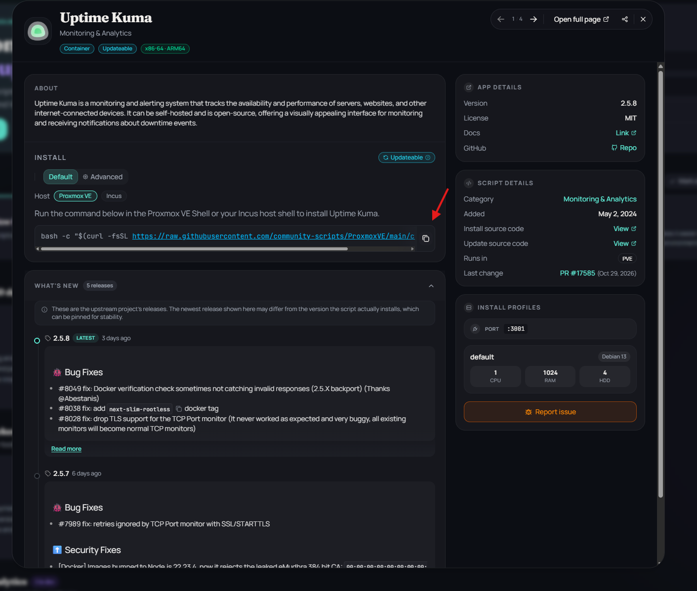

Run it from the **Proxmox host shell** (Node → Shell), not inside a container:

```bash
bash -c "$(curl -fsSL https://raw.githubusercontent.com/community-scripts/ProxmoxVE/main/ct/uptimekuma.sh)"
```

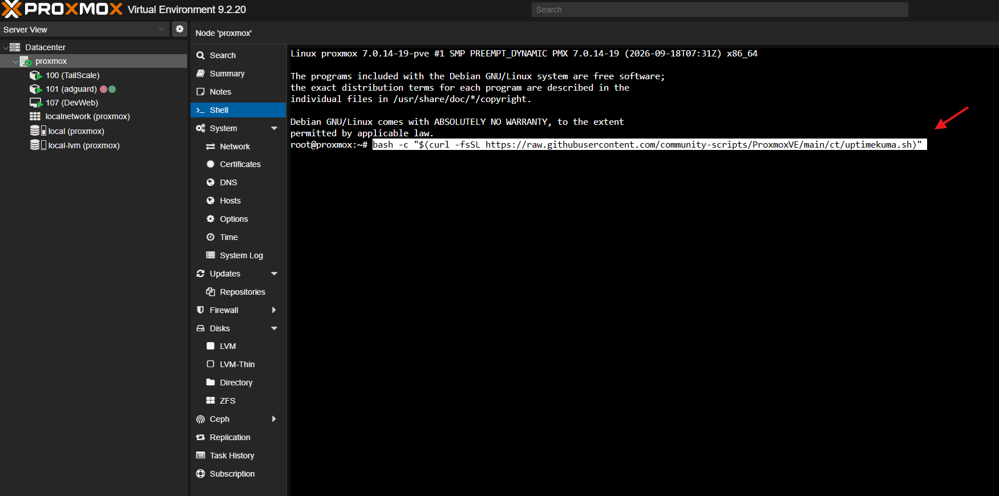

> **Trust check:** this pipes a script from the internet into `bash` as root
> on the hypervisor. The script page links the install source code, and
> reading it before running anything as root is a good habit.

---

## Part 2: Advanced Install, every choice explained

**Advanced Install** walks through about 30 settings instead of accepting
defaults. That's how I pinned a static IP and kept the container as locked
down as the service allows.

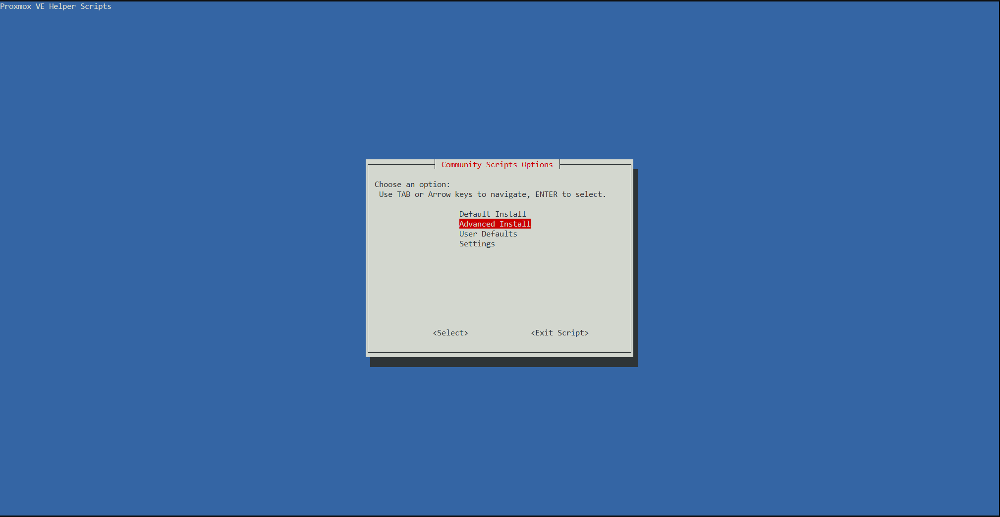

### Identity and resources

| Setting | Value | Why |
|---|---|---|
| Container type | **Unprivileged** | Root inside the container isn't root on the host. This is the default for anything I run. |
| Root password | set (strong) | Needed for console login. It goes into Vaultwarden later. |
| CT ID | `102` | Next after Tailscale (100) and AdGuard (101). The ID matches the last octet of the IP, which keeps the lab easy to read. |
| Hostname | `uptimekuma` | Says what it is |
| Disk / CPU / RAM | 4 GB / 1 core / 1024 MB | The script's default profile. Plenty for a few dozen monitors. |


### Network: the part I almost got wrong

| Setting | Value | Why |
|---|---|---|
| Bridge | `vmbr0` (home LAN) | It has to reach the services it monitors, which all live on the LAN. |
| IPv4 | **static** `192.168.50.102/24` | A monitor's address shouldn't move, and Homepage will point at it. |
| Gateway | **`192.168.50.1`** (the router) | The gateway is whatever *routes traffic out*. That's the router, never AdGuard. |
| IPv6 | auto (SLAAC) | Default. The network has no IPv6 internet, which is harmless. |
| MTU | blank (1500) | Default |

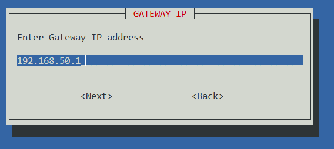

> **Gateway ≠ DNS server.** Partway through, I wasn't sure whether the
> gateway should be AdGuard's IP (`.101`). It shouldn't. AdGuard *answers
> name lookups*; it doesn't forward packets. With the gateway set to `.101`,
> the container would have no internet at all: no alerts, no updates. The
> only place AdGuard's IP ever belongs is a **DNS** field.

### DNS: keeping the monitor independent

| Setting | Value | Why |
|---|---|---|
| DNS search domain | blank | There's no local domain yet. `faid.lab` arrives with Active Directory. |
| DNS server | **`9.9.9.9`** (Quad9) | See below |

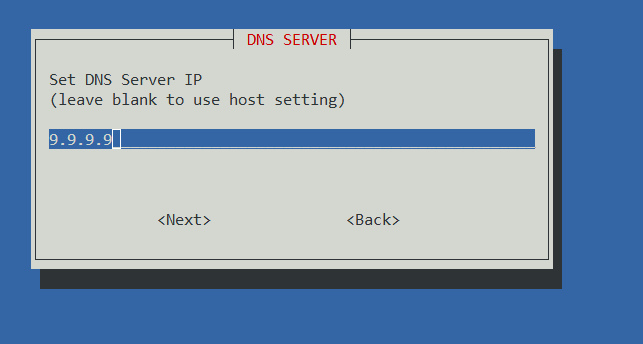

> **Why not point it at AdGuard?** If Uptime Kuma used AdGuard for DNS and
> AdGuard went down, Uptime Kuma couldn't resolve `api.telegram.org`. The
> alert saying "AdGuard is down" would never be sent. **A monitor should
> never depend on the thing it's monitoring.** A public resolver keeps the
> alert path working.

### Access and capabilities: least privilege

| Setting | Value | Why |
|---|---|---|
| SSH key source | **none** | No SSH needed. Management is through the web UI, the Proxmox console, or `pct enter 102`. |
| Root SSH access | **No** | One less login exposed to the network |
| TUN/TAP | **No** | Only VPNs need a tunnel device. Same question as the Tailscale CT, opposite answer. |
| Nesting | Yes (script default) | Proxmox and the script enable it for unprivileged Debian containers, because modern systemd inside the container relies on it. |
| FUSE, GPU, mknod, extra mounts | **No / none** | Uptime Kuma uses none of them |

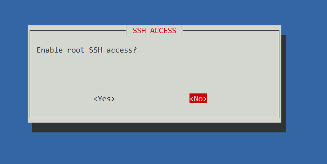
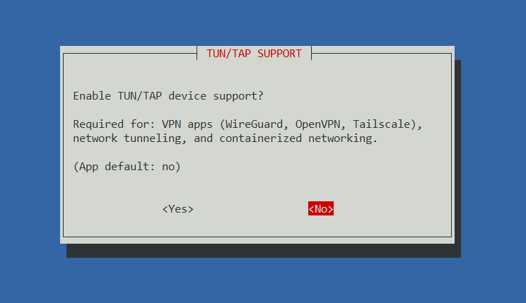

**The TUN/TAP question across the lab so far:**

| Container | TUN/TAP | Reason |
|---|---|---|
| 100 Tailscale | **Yes** | VPN: needs the tunnel device |
| 101 AdGuard | No | DNS server |
| 102 Uptime Kuma | No | Monitoring over normal HTTP, ping and DNS |

<details>
<summary><b>Every other wizard choice</b> (all left at default / No)</summary>

| Screen | Choice |
|---|---|
| Root password + verification | set |
| IPv6 | auto |
| MTU | blank (1500) |
| MAC address | blank (auto-generated) |
| VLAN tag | blank (none) |
| Container tags | `community-script;analytics;monitoring` (default) |
| FUSE | No |
| Nesting | Yes |
| GPU passthrough | No |
| Device node creation (mknod) | No |
| Mount filesystems | none |
| Container protection | No |
| APT Cacher-NG proxy | No |
| HTTP/HTTPS proxy | No |
| Container timezone | inherited from host (redacted) |
| Post-install hook | none |
| Verbose mode | No |

</details>

### Confirm and save

The summary shows every choice before anything is built:

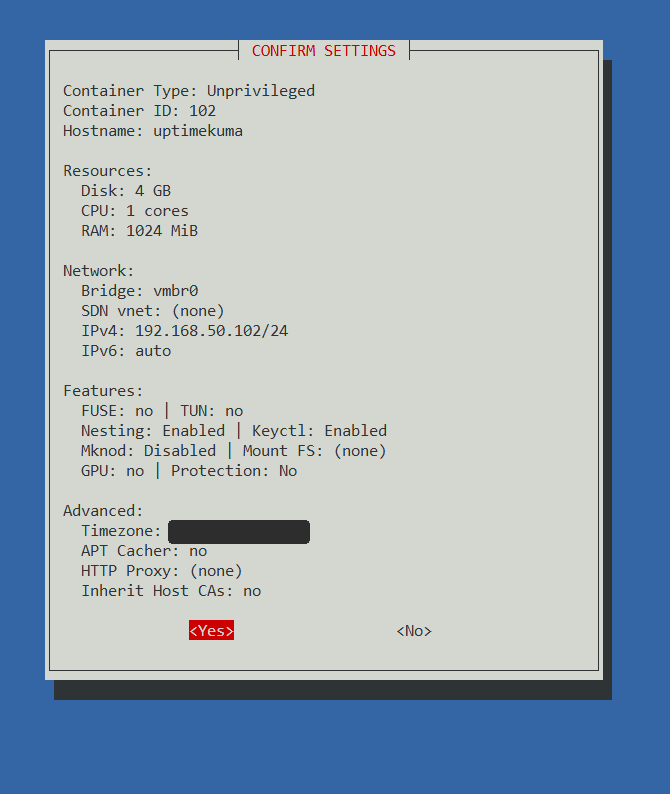

I saved the settings as defaults (`/usr/local/community-scripts/defaults/uptimekuma.vars`).
If I ever rebuild this container, it's one command with identical settings.
That's reproducibility for free.

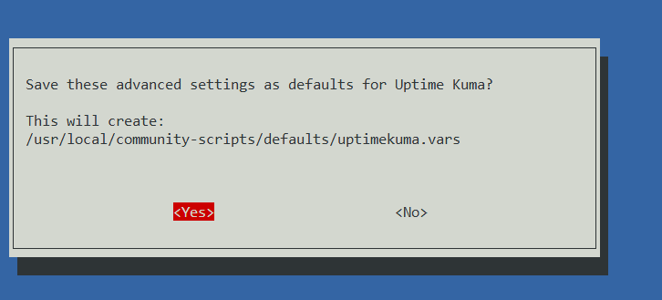

---

## Part 3: Install, update, reboot

The script creates the container, installs Node.js 22 and Uptime Kuma 2.5.8,
creates the service, and prints the URL:

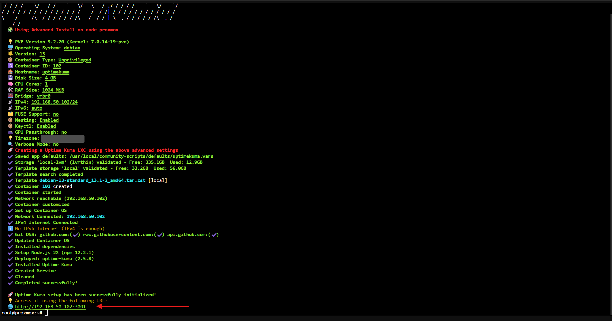

> **"No IPv6 Internet (IPv4 is enough)"** in the output is informational, not
> an error. Same as on the AdGuard build.

Then open the container's **Console** in Proxmox and update it:

```bash
apt update && apt upgrade -y
systemctl reboot
```

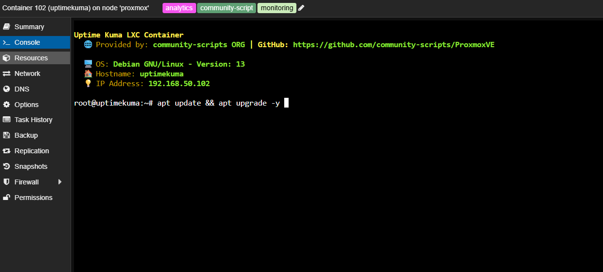
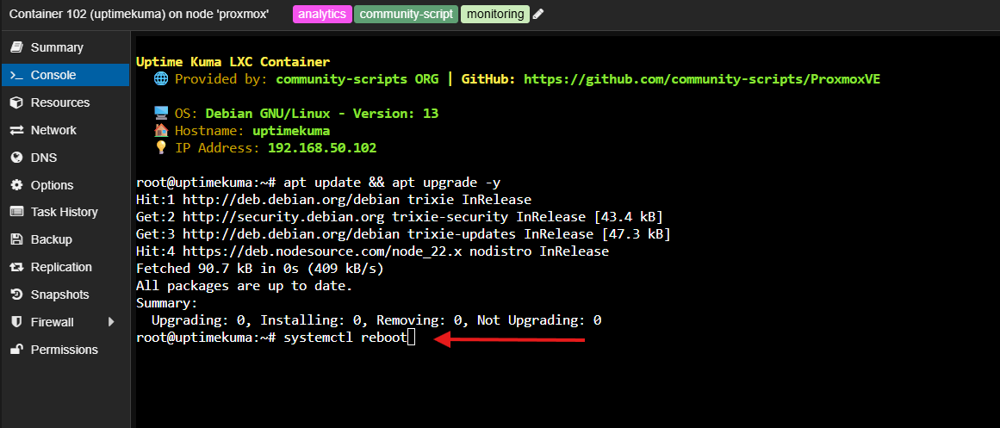

Everything was already current, because the script updates the OS during
install. I still run the update by habit on every new container. The
**reboot** proves the Uptime Kuma service comes back on its own. A monitor
that doesn't survive a restart isn't much of a monitor.

> **Two related checks:**
> - `apt upgrade` updates the operating system, **not Uptime Kuma itself**.
>   The app is updated with the community-scripts `update` command inside
>   the container's console.
> - Make sure **CT 102 → Options → Start at boot** is **Yes**, so monitoring
>   comes back after a Proxmox host reboot too.

---

## Part 4: First run

Browse to `http://192.168.50.102:3001`.

**Database: SQLite.** It's a single file with nothing extra to run or
maintain, and it's recommended for small deployments. MariaDB/MySQL makes
sense at a much larger scale.

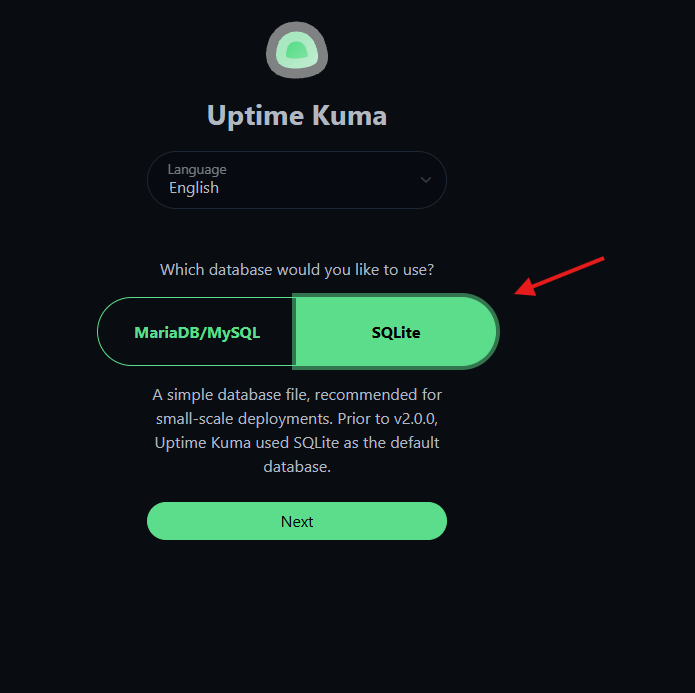

Then create the admin account (a strong password that goes into Vaultwarden
later), and the empty dashboard is ready for monitors.

---

## Part 5: Monitors

**+ Add New Monitor** for each service.

### Proxmox host

| Field | Value |
|---|---|
| Monitor type | HTTP(s) |
| URL | `https://192.168.50.151:8006` |
| Heartbeat interval | 30 seconds |
| Retries | 0 |
| **Ignore TLS/SSL errors** | ✅. Proxmox uses a self-signed certificate. Without this, the monitor reports "down" when it's really "untrusted cert". |

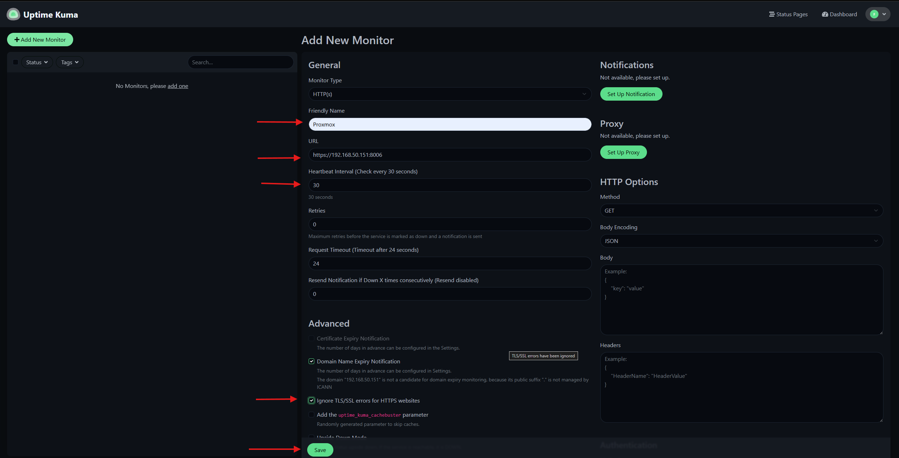

### AdGuard admin page

| Field | Value |
|---|---|
| Monitor type | HTTP(s) |
| URL | `http://192.168.50.101` |
| Heartbeat interval | 30 seconds |
| Retries | 0 |


> **Retries 0 vs 2:** with 0 retries, a single failed check sends an alert
> immediately. That's the fastest detection, but one network blip pages me.
> If it gets noisy, setting retries to 2 means a service must fail three
> checks in a row (about 90 seconds) before alerting.

> **"Domain Name Expiry Notification"** is ticked by default. Uptime Kuma
> notes that a bare IP isn't a domain, so it simply doesn't apply here.

---

## Part 6: Telegram alerts

**Profile menu → Settings → Notifications → Set Up Notification →
Notification Type: Telegram**

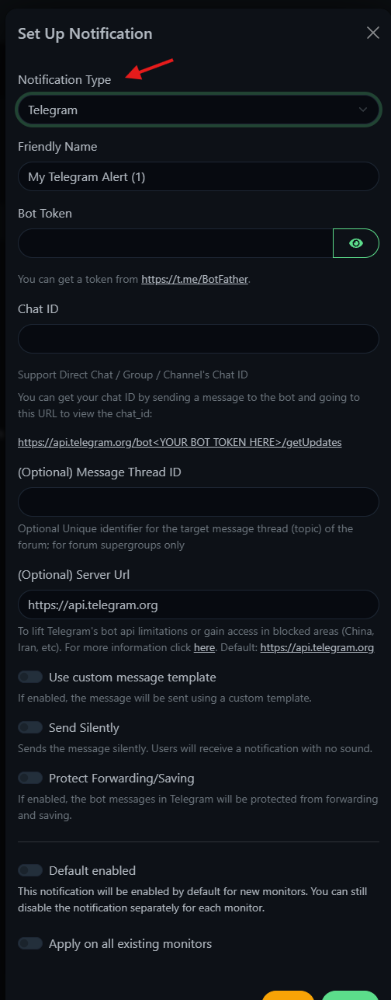

### 1. Create the bot with @BotFather

In Telegram, message **@BotFather** → `/newbot` → pick a display name → pick a
username ending in `bot`. It took several tries to find a username BotFather
accepted. BotFather then replies with the **bot token**.

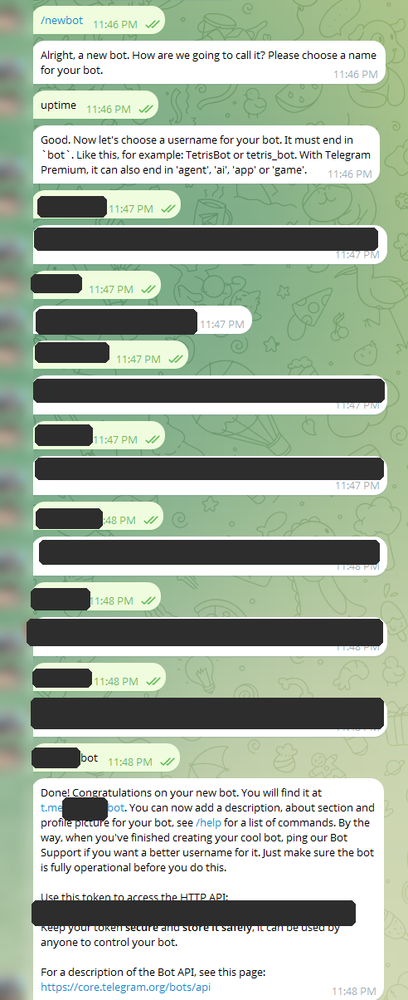

### 2. Token and Chat ID

Paste the token into **Bot Token**. Then open the new bot in Telegram, tap
**Start**, and send it any message. Back in Uptime Kuma, click **Auto Get** to
fill in the **Chat ID**.

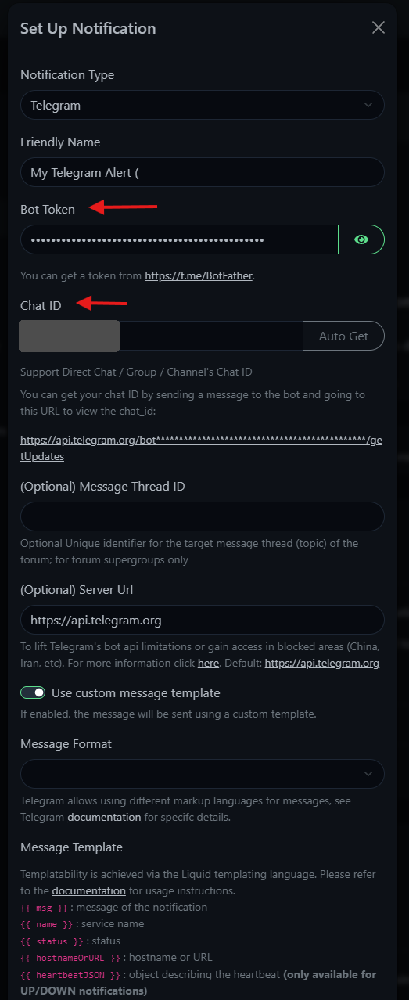

> **The bot token is a password.** Anyone with it can send messages as the
> bot. It's never pasted into chat or committed anywhere, and both the
> token and the Chat ID are redacted in every screenshot. If it ever leaks,
> `/revoke` in BotFather issues a new one.

### 3. Message template, format, test, save

I turned on a custom template so alerts are short and readable on a phone:

```
{{ status }} {{ name }}
Target: {{ hostnameOrURL }}
Detail: {{ heartbeatJSON['msg'] }}
Time: {{ heartbeatJSON['localDateTime'] }}
```

The `` block keeps the **Test** button working, because
test alerts carry no heartbeat data.

| Setting | Value | Why |
|---|---|---|
| Message format | **Plain Text** | MarkdownV2 treats `.` and `-` as formatting characters that must be escaped, and every IP address is full of dots. Plain text avoids that. |
| Default enabled | On | Every *new* monitor gets this alert automatically |
| **Apply on all existing monitors** | **On** | Attaches the alert to monitors that already exist. See Challenges. |

**Test** → **Save**.

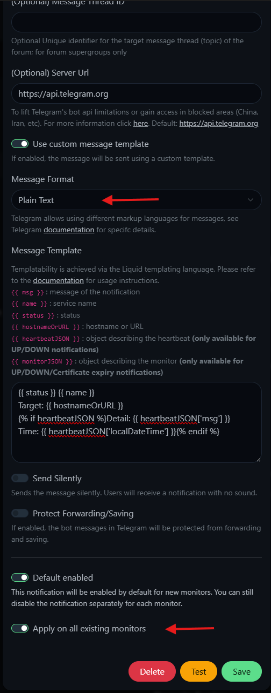

The test message arrives in Telegram, which confirms the bot token, Chat ID
and template all work:

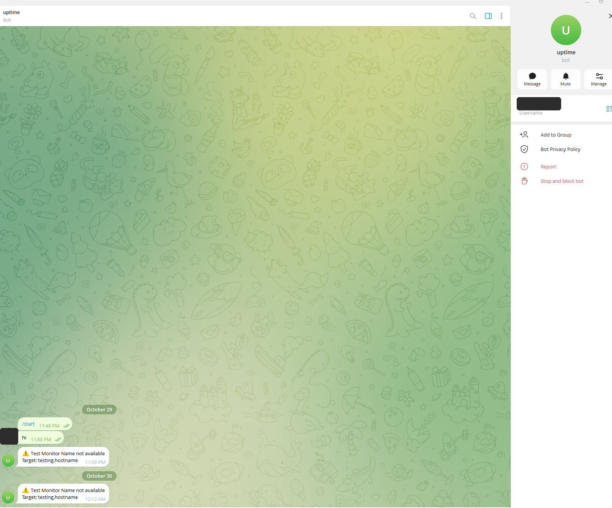

---

## Part 7: Complete the monitor set and prove it works

### AdGuard DNS: the monitor that matters most

The AdGuard *web* monitor only proves the admin page loads. The house depends
on AdGuard **answering DNS**, and the two can fail separately. This monitor
asks AdGuard to resolve a real domain:

| Field | Value |
|---|---|
| Monitor type | DNS |
| Hostname (to look up) | `google.com` |
| Resolver server | `192.168.50.101` (AdGuard) |
| Port | `53` |
| Record type | `A` |
| Heartbeat interval | 30 seconds |

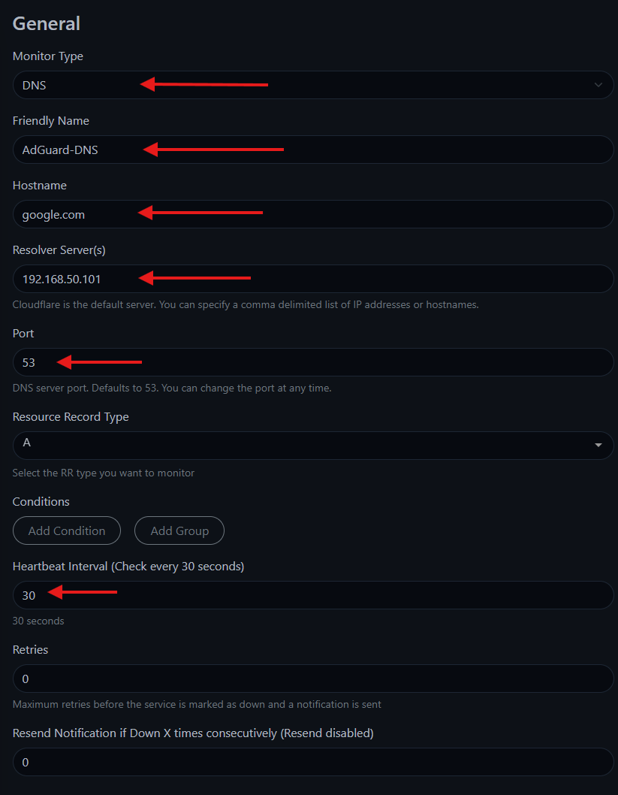

### Tailscale

The Tailscale container has no web page, so it's a **Ping** monitor on
`192.168.50.100`.

### All green

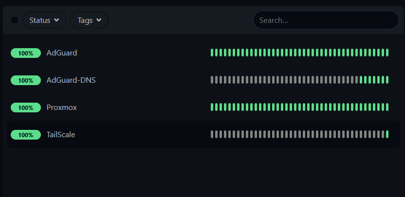

### Failure test: stop a service on purpose

A monitor you've never seen fail is a monitor you're trusting blindly. I
stopped the Tailscale container from the Proxmox host shell. I picked
Tailscale because stopping it only cuts remote access while I'm at home;
stopping AdGuard would take DNS down for the whole house.

```bash
pct stop 100
```

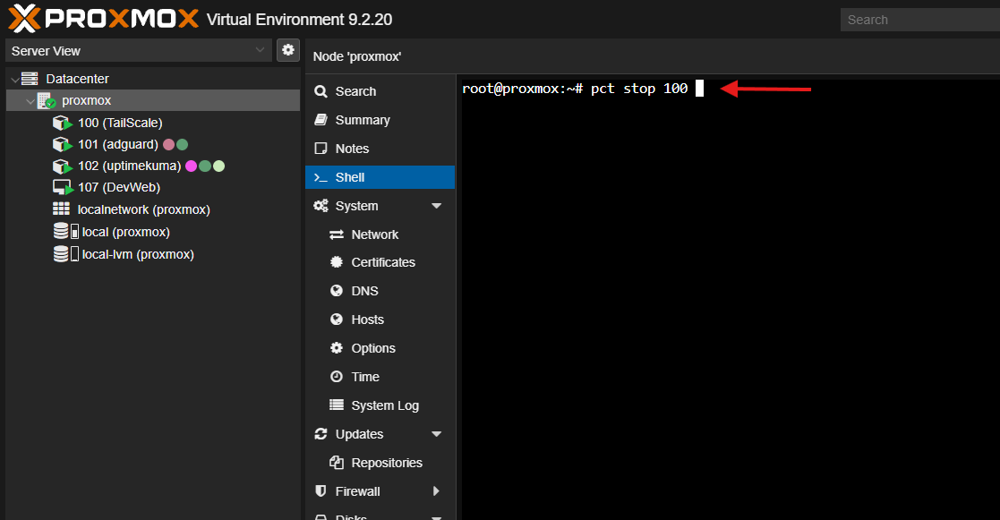

The **Down** alert reached my phone. First it showed plain packet loss, then
"Destination Host Unreachable" once the container's address dropped off the
network:

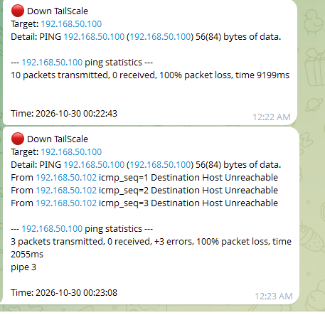

Then I brought it back:

```bash
pct start 100
```

The **Up** alert followed:

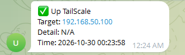

That's the whole loop proven: **failure → detection → alert → recovery →
all-clear**.

---

## Challenges & notes

### Alerts weren't attached to my first two monitors
I created the Proxmox and AdGuard monitors *before* setting up Telegram.
**Default enabled** only applies to monitors created *afterwards*, so those
two would have failed silently. Turning on **Apply on all existing monitors**
and saving attached the alert to them. Lesson: after adding a notification,
check that every monitor actually has it.

### Message format: MarkdownV2 → Plain Text
I first picked MarkdownV2. It requires escaping characters like `.` and `-`,
which appear in every IP address and hostname. I switched to Plain Text,
since the template doesn't need formatting anyway.

### Gateway vs DNS server
The one real mix-up on this build: I wasn't sure whether AdGuard's IP belonged
in the gateway field. It doesn't. The gateway routes traffic, DNS resolves
names. A wrong gateway takes a container fully offline, so it's worth getting
right in my head now, before the OPNsense phase adds four more subnets and
four more gateways.

### A monitor must not depend on what it monitors
Uptime Kuma's DNS is Quad9, not AdGuard, so the "AdGuard is down" alert can
still get out when AdGuard is down.

### Defaults are a starting point
The script's defaults were good, but Advanced Install was the only way to set
a static IP, independent DNS, and no SSH. That's three security- or
reliability-relevant choices a Default Install would have made for me.

---

## Lessons learned

1. **Monitoring is part of the build, not an afterthought.** Every service
   added from here gets a monitor the same day.
2. **Design the alert path to survive the failure it reports.** Independent
   DNS, and alerts sent off-box to Telegram.
3. **Gateway routes, DNS resolves.** Mixing them up breaks everything quietly.
4. **Least privilege is a habit, not a setting.** No SSH, no TUN, no extra
   device access: decided screen by screen, by what the service needs.
5. **Reboot to verify.** A service that only works until the next restart
   isn't really working.
6. **Test the alert path end-to-end.** A Test button proves the bot works;
   only a real outage (`pct stop`) proves the monitor, the alert and the
   recovery all work together.

---

*Screenshots are redacted: the bot token, Chat ID, bot username, Telegram
profile photos and the container timezone are covered. The lab's `192.168.50.x` addresses are left
visible. They're private (RFC 1918) and not reachable from the internet.
Image metadata is stripped.*

**Coverage so far / next to add:**

| Service | Monitored |
|---|---|
| Proxmox host (HTTPS) | ✅ |
| AdGuard admin page (HTTP) | ✅ |
| AdGuard DNS (DNS query) | ✅ |
| Tailscale CT (Ping) | ✅ |
| Home router (Ping) | next |
| Internet, e.g. `9.9.9.9` (Ping): "is it my lab or my ISP?" | next |
| Every new service in later builds | the same day it's built |

*Next in the build: [Homepage](../04-homepage/) (one dashboard for every service, with live
Uptime Kuma status, which needs an Uptime Kuma **status page**), then Nginx
Proxy Manager + Vaultwarden, then OPNsense and the segmented lab networks.*
