# Nginx Proxy Manager: Real HTTPS for Every Lab Service (Proxmox LXC)

[← Back to lab overview](../README.md) · [← Previous: Homepage](../04-homepage/)

Part of my **Home SOC Lab v2** rebuild, and the first build of Phase 2. After
Phase 1, every service had its own `http://IP:port` address and every login
crossed the network in plain text. Nginx Proxy Manager (NPM) gives each one a
real name and a **trusted HTTPS certificate**, without opening a single port
on my router.

| Before | After |
|---|---|
| `http://192.168.50.101` | `https://adguard.lab.faidalani.com` |
| `http://192.168.50.102:3001` | `https://uptime.lab.faidalani.com` |
| `http://192.168.50.103:3000` | `https://home.lab.faidalani.com` |
| `https://192.168.50.151:8006` (certificate warning) | `https://proxmox.lab.faidalani.com` |
| `http://192.168.50.104:81` | `https://npm.lab.faidalani.com` |

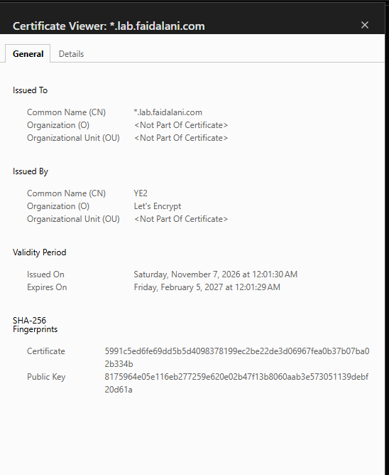

---

## What NPM does

A **reverse proxy** sits in front of other web servers. The browser talks
only to the proxy, and the proxy forwards each request to the right service
based on the name in the address bar:

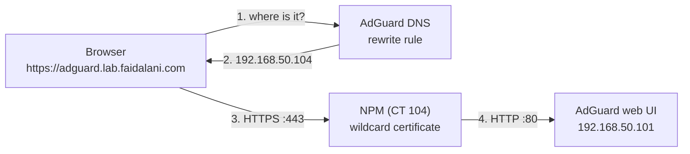

NPM is Nginx (OpenResty) with a web UI on top. It does three jobs:

| Job | How |
|---|---|
| **Routing by name** | One "proxy host" per service: a domain name mapped to an IP and port |
| **TLS termination** | The HTTPS connection ends at NPM, which holds the certificate |
| **Certificates** | Built-in Certbot requests and renews Let's Encrypt certificates on its own |

## Why it's worth running

| Benefit | What it means in practice |
|---|---|
| **Logins are encrypted** | AdGuard, Uptime Kuma and Proxmox passwords no longer cross the LAN in plain text |
| **A real, trusted certificate** | Green padlock, no "proceed anyway" warnings. Clicking through warnings is a bad habit to train. |
| **Names instead of IP:port** | `uptime.lab.faidalani.com` instead of remembering `192.168.50.102:3001` |
| **Zero inbound ports** | The certificate is proven through DNS, not by letting Let's Encrypt connect in |
| **One place for certificates** | One wildcard certificate covers every service and renews itself |
| **Same names at home and away** | Tailscale split DNS sends lab names to AdGuard from anywhere (Part 8) |
| **Needed for what's next** | Vaultwarden (build 06) needs HTTPS: browsers only allow its encryption code on secure pages |

**What this shows:** reverse proxying · TLS and PKI · the ACME DNS-01
challenge · least-privilege API tokens · split-horizon DNS · troubleshooting
DNS filtering from query logs · WebSocket and redirect debugging

---

## Goal

| Item | Value |
|---|---|
| Container | Unprivileged LXC, Debian 13 |
| CT ID / hostname | `104` / `nginxproxymanager` |
| Resources | 2 vCPU · 2048 MB RAM · 8 GB disk (script default) |
| Network | `vmbr0`, static **192.168.50.104/24**, gateway `192.168.50.1` |
| DNS server | `9.9.9.9` (Quad9) |
| Ports | `80` HTTP (redirects to HTTPS) · `443` HTTPS · `81` admin UI |
| Versions | Nginx Proxy Manager 2.16.0 · OpenResty 1.29 · Node.js 22 |
| Domain | `*.lab.faidalani.com` (DNS hosted on Cloudflare) |
| Certificate | Let's Encrypt wildcard, issued with the DNS-01 challenge |

> **What you need first:** a domain you own, with its DNS hosted somewhere
> Certbot can talk to (Cloudflare here). I checked that `faidalani.com` was
> on Cloudflare with `nslookup -type=NS faidalani.com`. The answer was two
> `*.ns.cloudflare.com` name servers.

---

## Part 1: Install

Same source as every build so far: the Proxmox VE Community Scripts project.
The page lists the ports and, for this version, **no default login**:
the first visit opens a setup wizard.

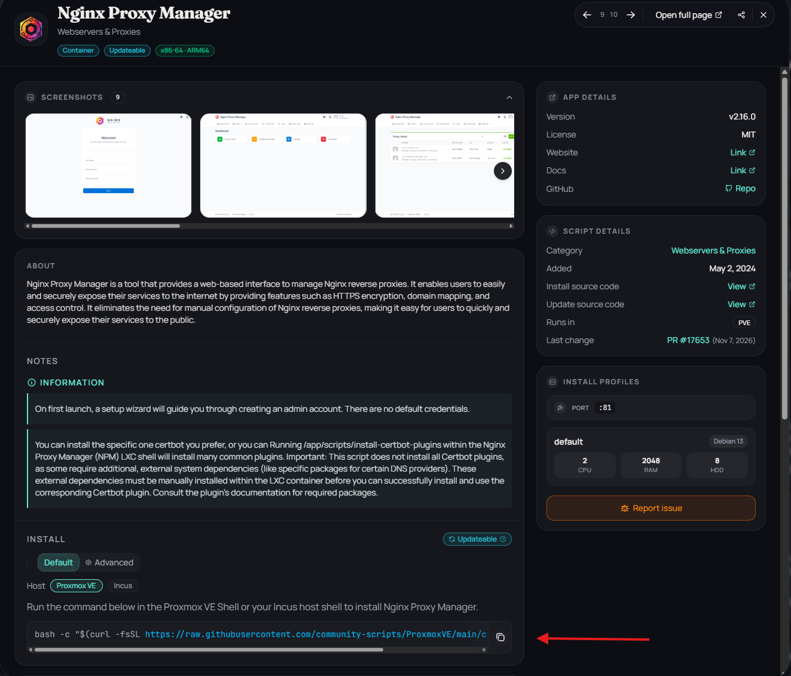

Run it from the **Proxmox host shell**:

```bash
bash -c "$(curl -fsSL https://raw.githubusercontent.com/community-scripts/ProxmoxVE/main/ct/nginxproxymanager.sh)"
```

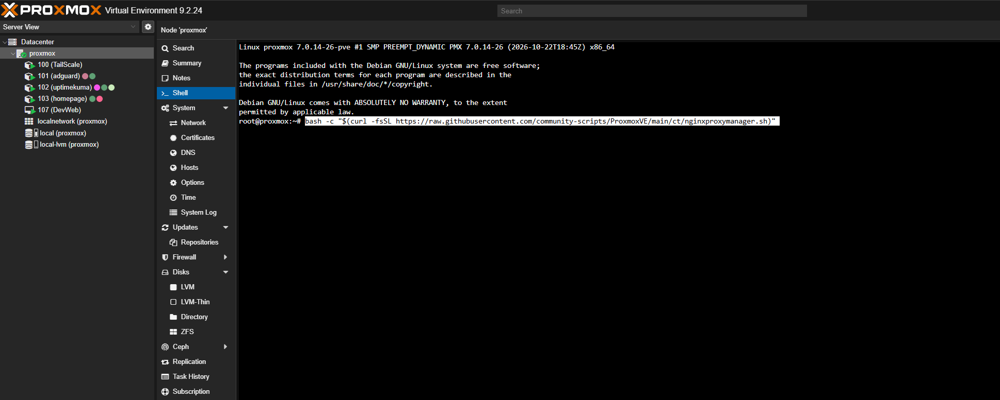

I chose **Advanced Install** again instead of trusting the saved *App
Defaults* from the old lab ([why](../04-homepage/#challenges--fixes)). The
wizard is the same one used in builds 02 to 04
([every choice explained](../03-uptime-kuma/#part-2-advanced-install-every-choice-explained)),
so here are only this build's choices:

| Setting | Value | Why |
|---|---|---|
| Container type | **Unprivileged** | Root in the container isn't root on the host |
| CT ID / IP | `104` / `192.168.50.104/24` | ID matches the last octet, like 100 to 103 |
| Disk / CPU / RAM | 8 GB / 2 / 2048 MB | Script default. NPM builds its frontend during install. |
| DNS server | `9.9.9.9` | Certbot must reach Let's Encrypt and Cloudflare even if AdGuard is down |
| TUN/TAP | **No** | No tunneling |
| Console mode | `tty` | The default login console in the Proxmox UI |
| Inherit Host CAs | **No** | Copies the host's trusted CA certificates in. Only needed with a private CA. Let's Encrypt is already trusted. |

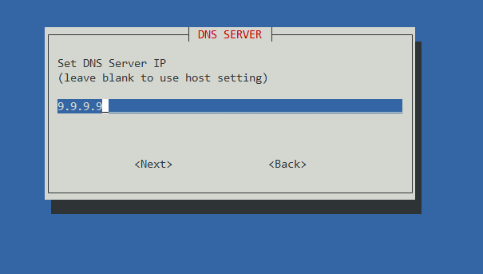
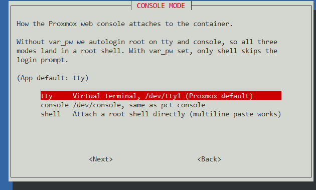
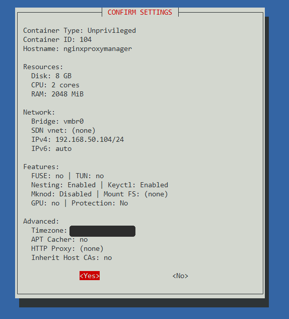

The script installs Certbot, builds OpenResty, deploys NPM 2.16.0 and prints
the admin URL on port **81**:

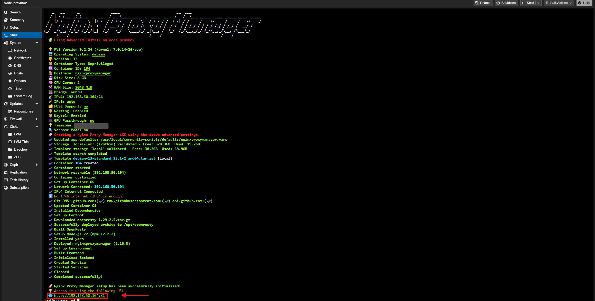

---

## Part 2: Lock it down

### Update the container first

From **CT 104 → Console**. The prompt has to say `root@nginxproxymanager`,
not `root@proxmox`. Running this on the host by mistake was a lesson from the
[last build](../04-homepage/).

```bash
apt update && apt upgrade -y
```

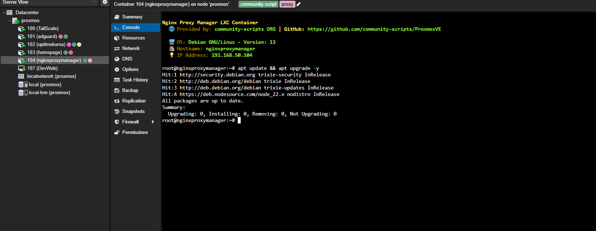

> **Updating NPM itself** is a different command. Community-scripts
> containers have an `update` command that pulls the new app version:
> run `update` in the CT 104 console.

### Create the admin account

Older guides (and my own notes) say the first login is `admin@example.com` /
`changeme`. This version has **no default account**. The first visit to
`http://192.168.50.104:81` opens a setup wizard instead, so there is never a
window where a known password works.

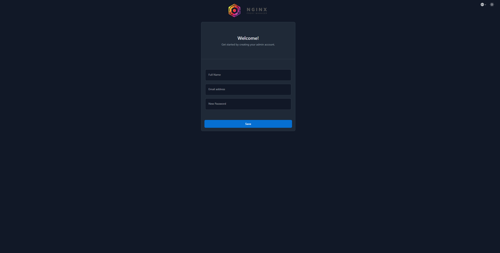

Then:

- **Two-factor authentication (TOTP):** turned on from the user menu (top
  right) and scanned into my authenticator app. NPM controls HTTPS for every
  service, so its login deserves the second factor.
- **Default site → 404 Page** (**Settings → Default Site**). This is what NPM
  shows when a request arrives with a name it doesn't know, such as a scanner
  hitting the IP directly. The default "Congratulations" page tells a scanner
  exactly what software is running. *No Response (444)* is even quieter.

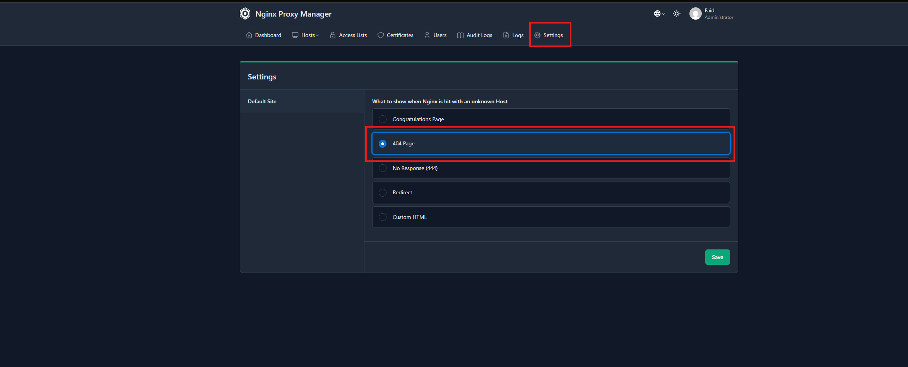

---

## Part 3: A Cloudflare API token that can only do one thing

To prove I own the domain, Certbot will create a temporary DNS record. That
needs API access to Cloudflare, and there are two ways to give it:

| Option | Access | Verdict |
|---|---|---|
| Global API Key | **Everything** in the Cloudflare account: every zone, Workers, billing settings | ❌ Never for this |
| **Scoped API token** | DNS edit on **one zone** only | ✅ Least privilege |

**Cloudflare → My Profile → API Tokens → Create Token:**

- Token name: `npm-lab-dns`
- Permission: **Zone → DNS → Edit**
- Zone resources: **Include → Specific zone → `faidalani.com`**

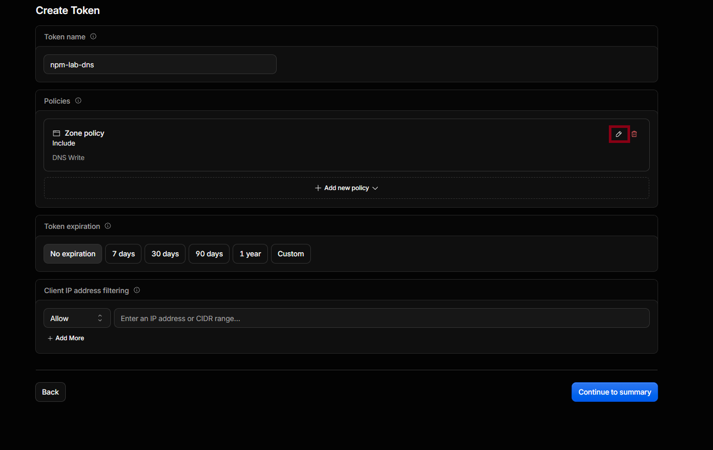
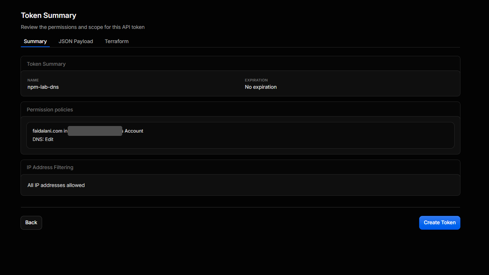

My account already had a token Cloudflare created automatically for this
website's build pipeline, with **27 permissions**. Reusing a token like that
would have been the easy path and handed NPM far more power than it needs.
One job, one token.

> **Where the token ends up:** NPM keeps it in **plain text** inside the
> container (its database and a credentials file). That's why it's scoped:
> if CT 104 is ever compromised, the attacker gets DNS edit on one zone, not
> the account. It also means **backups of CT 104 are sensitive** and need
> the same care as the token.

The token is shown once. I copied it straight into NPM and never saved it
anywhere else.

---

## Part 4: One wildcard certificate (DNS-01 challenge)

**Certificates → Add Certificate → Let's Encrypt via DNS**

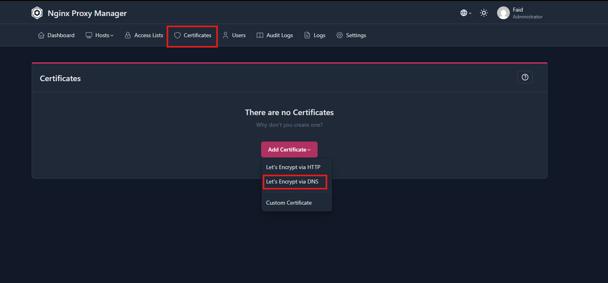

| Field | Value |
|---|---|
| Domain names | `*.lab.faidalani.com` |
| DNS provider | Cloudflare |
| Credentials file | `dns_cloudflare_api_token=` + the token from Part 3 |

The form pre-fills an **example** credentials line. Replace the whole value
with the real token:

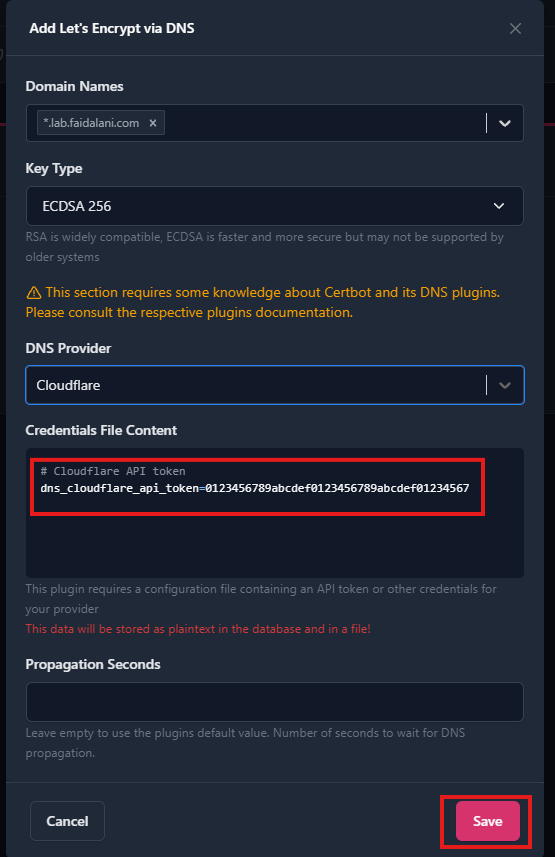

What happens when you press Save:

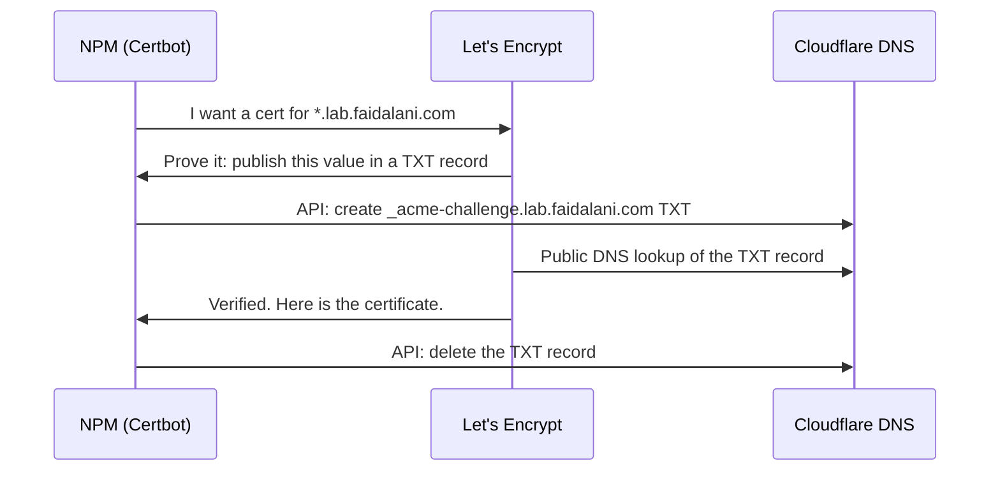

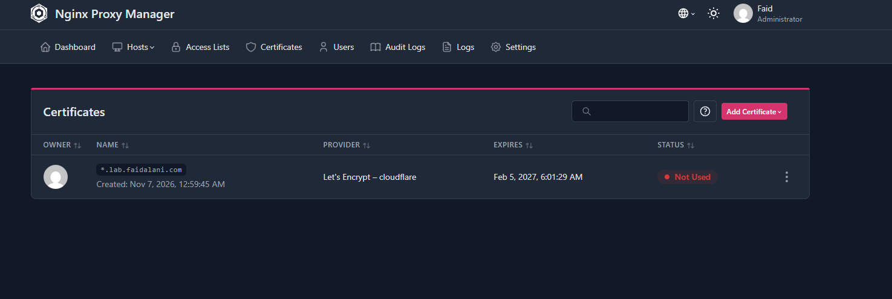

**Why the DNS challenge and not HTTP:**

- **No inbound ports.** The HTTP challenge needs Let's Encrypt to connect to
  port 80 on my public IP. The DNS challenge only needs an outbound API
  call, so the router stays closed. This fits the lab's zero-inbound-ports
  rule from [build 01](../01-tailscale/).
- **Wildcards need it.** Let's Encrypt only issues wildcard certificates
  through DNS-01.
- **Less exposure in public logs.** Every public certificate is recorded in
  **Certificate Transparency (CT) logs**, which anyone can search. Five
  separate certificates would list every service name. A wildcard only
  reveals `*.lab.faidalani.com`.

The result: one ECDSA certificate from Let's Encrypt, valid for 90 days. NPM
renews it on its own before it expires.

---

## Part 5: Split-horizon DNS (the names only exist at home)

The certificate is public, but the **names stay private**. I didn't create
any public DNS records for the lab. Instead, AdGuard answers for them on my
network.

**AdGuard → Filters → DNS rewrites → Add DNS rewrite:**
`*.lab.faidalani.com` → `192.168.50.104`

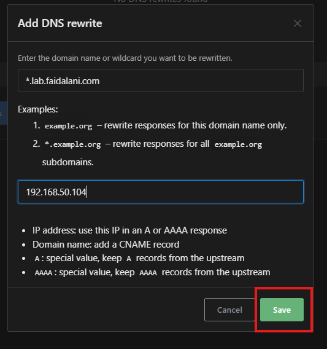

Every lab name now points to NPM, and NPM sorts them out by name. A new
service needs no new DNS record, only a new proxy host.

**Proof:**

```text
nslookup adguard.lab.faidalani.com          → 192.168.50.104  (asked AdGuard)
nslookup adguard.lab.faidalani.com 9.9.9.9  → name, no address (asked Quad9)
```

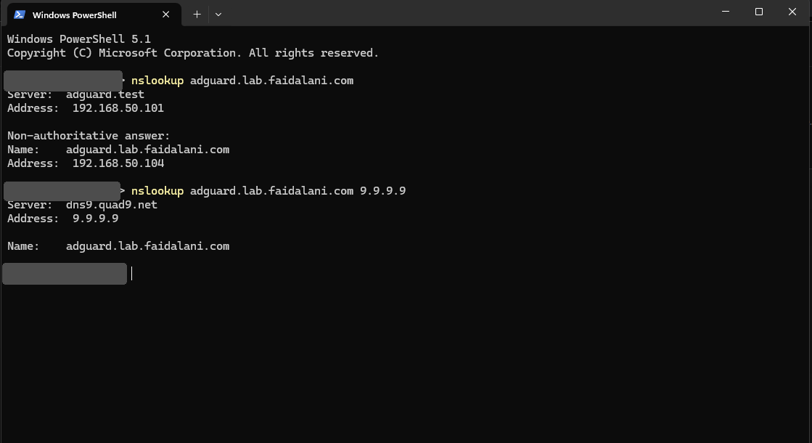

Inside the house, the name resolves. On the public internet it doesn't
resolve to anything, so the lab's internal layout isn't published anywhere.
(Quad9 returns the name with **no address** rather than "Non-existent
domain". The domain's Cloudflare name servers answer "no records of that
type" (called NODATA) instead of "doesn't exist" (NXDOMAIN). Either way,
there's no address to connect to.)

> **Same idea in enterprises:** "split-horizon" or "split-brain" DNS, where
> internal and external clients get different answers for the same zone.

---

## Part 6: Proxy hosts

**Hosts → Proxy Hosts → Add Proxy Host.** The steps are the same for every
service. Here's AdGuard as the worked example.

**Details tab**

| Field | Value |
|---|---|
| Domain names | `adguard.lab.faidalani.com` |
| Scheme | `http` |
| Forward hostname / IP | `192.168.50.101` |
| Forward port | `80` |
| Block Common Exploits | **On** (blocks common attack patterns in URLs, such as SQL injection and path traversal) |

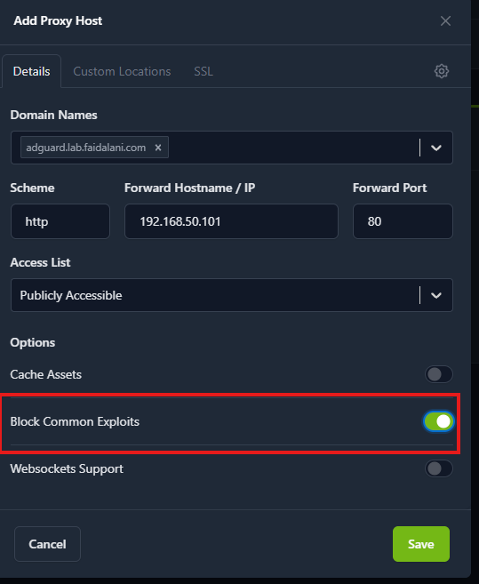

**SSL tab**

| Field | Value |
|---|---|
| SSL certificate | `*.lab.faidalani.com` |
| Force SSL | **On** (any `http://` request is redirected to `https://`) |
| HTTP/2 support | **On** |
| HSTS enabled | **On** (the browser remembers to use HTTPS only for this name) |

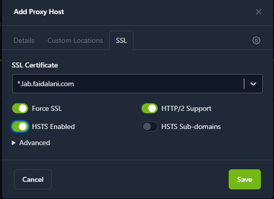

**Then do the same for every other service.** Only the name, scheme, IP,
port and WebSockets switch change:

| Domain | Scheme | Forward to | WebSockets | Note |
|---|---|---|---|---|
| `adguard.lab.faidalani.com` | http | `192.168.50.101:80` | Off | Worked example above |
| `uptime.lab.faidalani.com` | http | `192.168.50.102:3001` | **On** | Uptime Kuma's live dashboard runs over WebSockets |
| `home.lab.faidalani.com` | http | `192.168.50.103:3000` | Off | Also needs `HOMEPAGE_ALLOWED_HOSTS` (Part 7) |
| `npm.lab.faidalani.com` | http | `127.0.0.1:81` | Off | NPM's own admin UI. `127.0.0.1` because NPM proxies to itself inside CT 104. |
| `proxmox.lab.faidalani.com` | **https** | `192.168.50.151:8006` | **On** | See Challenges 1 and 2 |

The padlock is real: a public CA (Let's Encrypt), trusted by every browser,
for a name that only exists inside my network (certificate viewer at the top
of this page).

Back on the certificates page, the status changed from *Not Used* to
**In Use**:

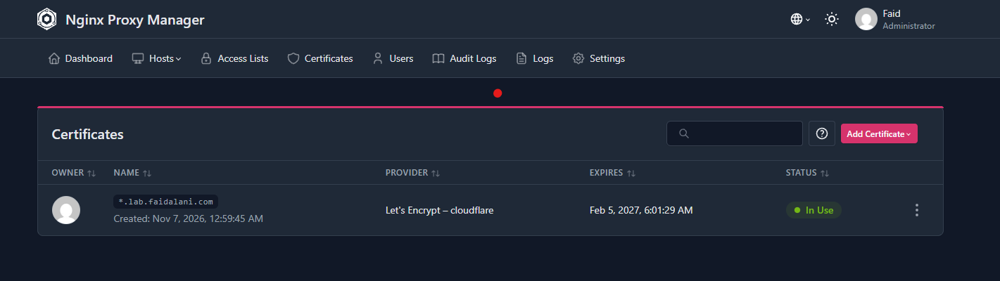

---

## Part 7: Wire it into the rest of the lab

### Homepage: clicks use names, widgets use IPs

The tile links (`href`) now point to the HTTPS names:

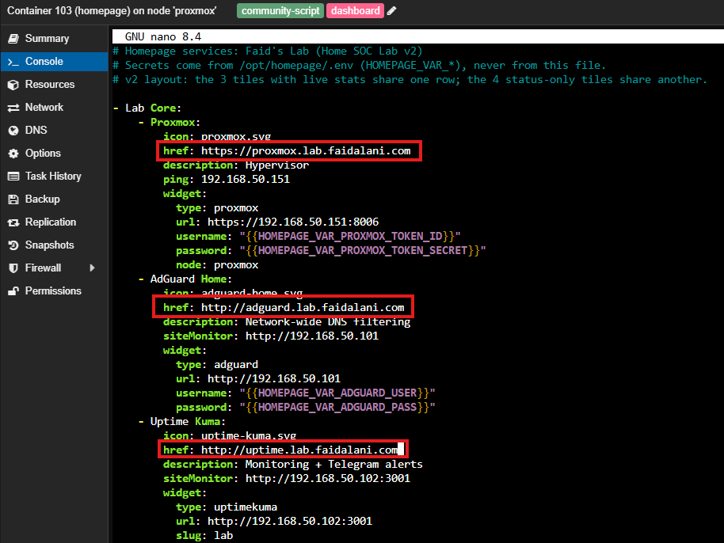

Use `https://` directly in the `href`. With `http://` it still works because
Force SSL redirects it, but that's an extra round trip on every click.

The **widgets stay on IPs** on purpose:

- CT 102 and CT 103 use Quad9 for DNS, which can't resolve lab names (Part 5).
- Monitoring shouldn't depend on the thing it monitors. If NPM goes down,
  the widgets and monitors still reach each service directly, and the NPM
  monitors below catch NPM itself.

Homepage also refuses requests for host names it doesn't know. Add the new
name to `HOMEPAGE_ALLOWED_HOSTS` in `/opt/homepage/.env` (comma-separated,
next to the existing values), then restart:

```bash
HOMEPAGE_ALLOWED_HOSTS=localhost:3000,192.168.50.103:3000,home.lab.faidalani.com
systemctl restart homepage
```

NPM got its own tile:

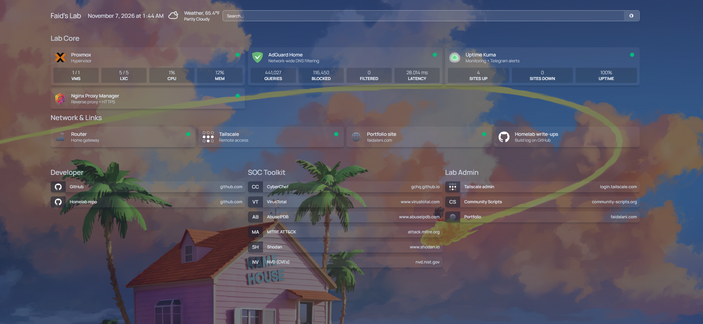

<sub>Background: Kame House (Dragon Ball) fan art wallpaper, found on r/wallpapers. Not my artwork; rights belong to its creators.</sub>

### Uptime Kuma: two monitors for NPM

- **NPM – Admin**: the admin UI on port 81
- **NPM – Proxy**: the proxy side that serves every HTTPS name

Two monitors tell "admin UI down" apart from "every lab link down". Add both
(plus Homepage) to the `lab` status page too, so the Homepage widget counts
every monitor.

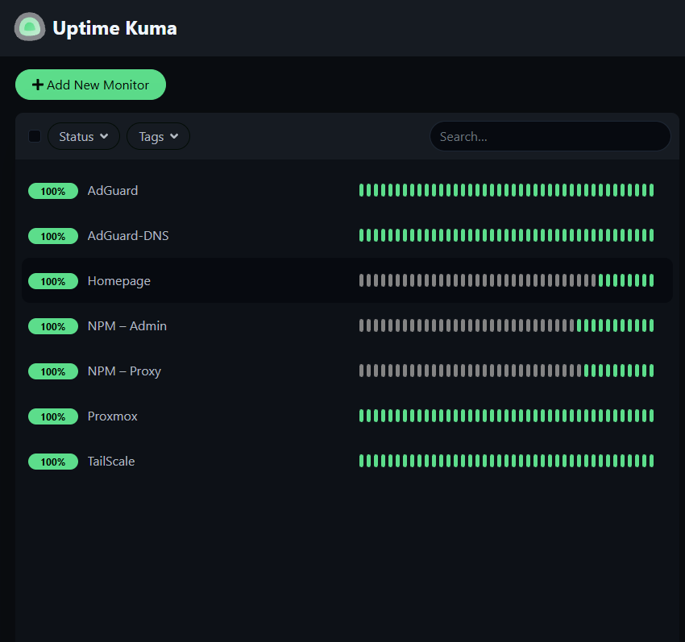

### Start at boot

Every service link now goes through CT 104, so it has to come back after a
power cut. **CT → Options → Start at boot = Yes** on all five containers.
**Start/Shutdown order** decides the sequence:

| Order | CT | Why |
|---|---|---|
| 1 | 101 AdGuard | Everything else needs DNS |
| 2 | 100 Tailscale | Remote access |
| 3 | 104 NPM | Every HTTPS name |
| 4 | 102 Uptime Kuma | Starts watching once the rest are up |
| 5 | 103 Homepage | Shows the result |

---

## Part 8: The same names over Tailscale

Away from home, my phone and laptop don't use AdGuard, so lab names don't
resolve. Tailscale **split DNS** fixes that by sending only lab names to
AdGuard through the subnet router from [build 01](../01-tailscale/):

**Tailscale admin console → DNS → Nameservers → Add nameserver → Custom:**

| Field | Value |
|---|---|
| Nameserver | `192.168.50.101` (AdGuard, reachable over the subnet route) |
| Restrict to domain (Split DNS) | **On** → `lab.faidalani.com` |
| Use with exit node | **On** |

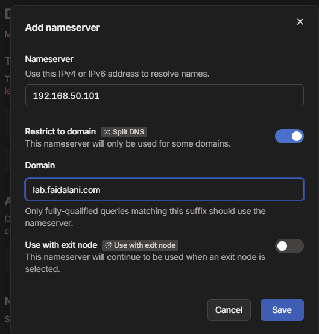

- **Restrict to domain** means only `*.lab.faidalani.com` questions go to
  AdGuard. Everything else uses the device's normal DNS.
- **Use with exit node:** without it, this nameserver stops being used while
  a device routes its traffic through the exit node. The screenshot shows it
  off; turn it on before saving.
- Leave **Override local DNS** off. It isn't needed for split DNS.

To test, turn Wi-Fi off on the phone, connect Tailscale, and open
`https://home.lab.faidalani.com`. Same name, same padlock as at home.

---

## Challenges & Fixes

### 1. Proxmox: "redirected you too many times"

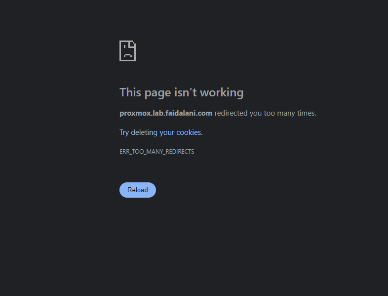

Every other service worked on the first try. Proxmox didn't. Its web UI
**only speaks HTTPS** on port 8006. With the scheme set to `http`, NPM spoke
plain HTTP to an HTTPS-only port, and the browser ended up bounced in a loop.

**Fix:** Scheme → **`https`**. The certificate on Proxmox is self-signed, but
that hop stays inside the host, and the browser only ever sees NPM's real
certificate.

### 2. Proxmox console: "failed waiting for client: timed out"

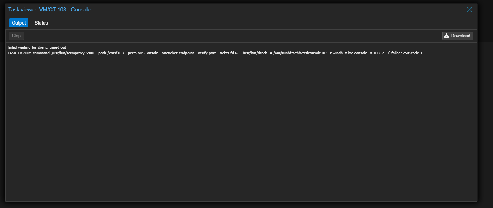

The Proxmox UI loaded fine through the proxy, but a container console
(CT 103 here) stayed blank and the task log showed a `termproxy` timeout. The
console is a **WebSocket**: an HTTP connection that upgrades into a
long-lived two-way channel. NPM drops that upgrade unless told otherwise, so
the terminal server waited for a client that never arrived.

**Fix:** Proxmox proxy host → **Websockets Support = On**. Block Common
Exploits can stay on. Uptime Kuma needs the same switch for its live
dashboard.

### 3. tailscale.com stopped loading (not NPM's fault)

While setting up Part 8, `tailscale.com` failed with
`DNS_PROBE_FINISHED_NXDOMAIN`. `nslookup` showed AdGuard answering
**`0.0.0.0` / `::`**, which is how AdGuard answers a blocked name. Quad9
returned real addresses.

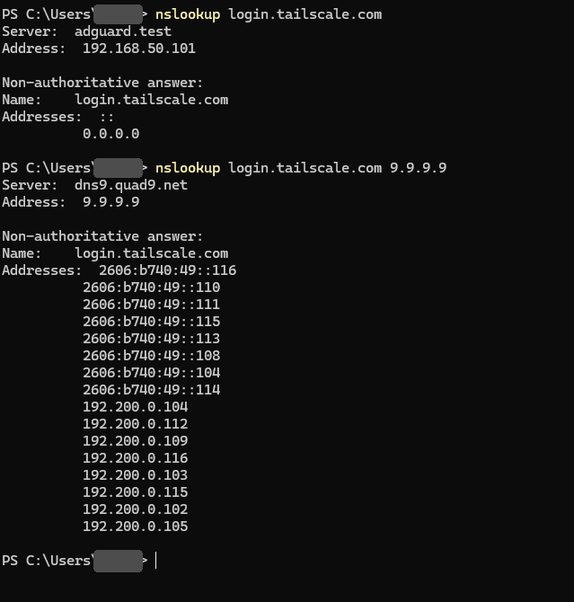

The **Query Log** filtered on `tailscale` named the cause: every request was
blocked by **HaGeZi's Encrypted DNS/VPN/TOR/Proxy Bypass** list. I had added
that list to AdGuard after [build 02](../02-adguard-home/).

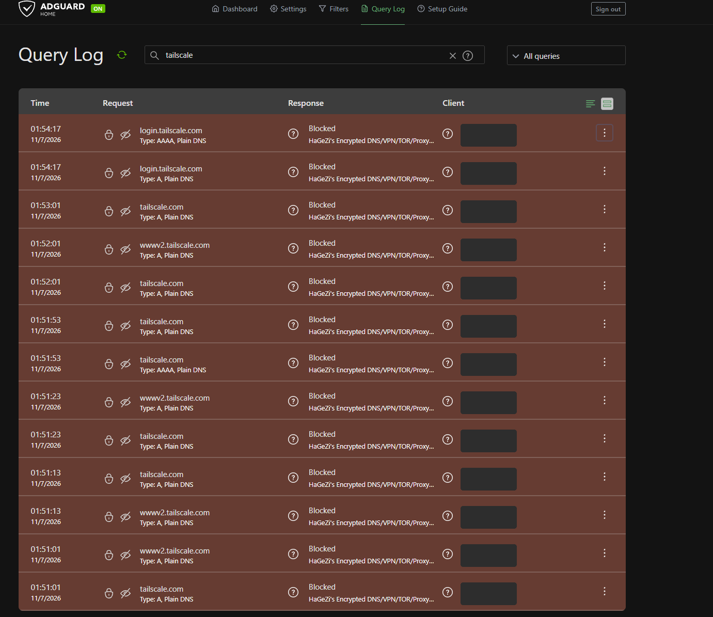

This wasn't a false positive. The list **works as designed**: it blocks
VPNs, proxies and encrypted-DNS services so devices can't route around the
DNS filter. Tailscale is a VPN, so it's on the list. Side effect: Tailscale
clients at home using AdGuard couldn't reach Tailscale's login and
coordination servers either.

**Fix:** a narrow exception instead of removing the whole list.
**Filters → Custom filtering rules:**

```text
@@||tailscale.com^
```

| Part | Meaning |
|---|---|
| `@@` | Exception: allow, even if a blocklist matches |
| `\|\|` | This domain and all its subdomains |
| `^` | End of the domain name |

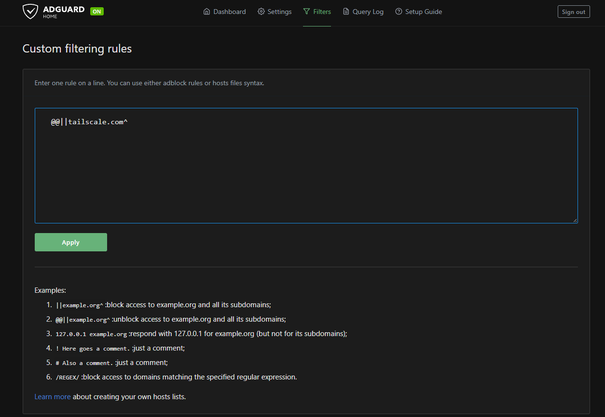

Then `ipconfig /flushdns` on the PC to drop the cached block. Now AdGuard
returns real addresses:

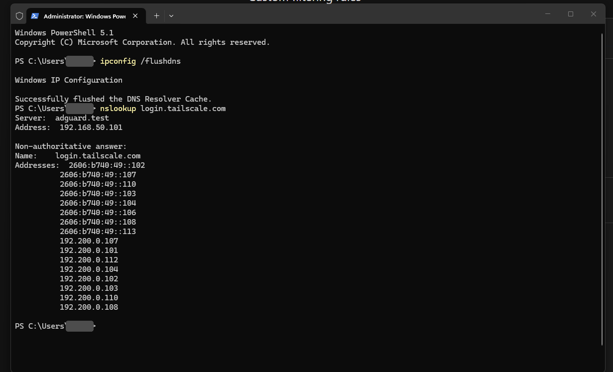

**SOC takeaway:** the browser said "doesn't exist", but the query log showed
the exact list and rule. In a real environment, the same check answers
"is this a network outage or our own security control?"

**Side note on typos:** while testing, I typed `taiscale.com` (missing the
`l`). It resolved to a parked page at a domain registrar. Nothing malicious
that time, but that's exactly how **typosquatting** works: register the
common misspelling and wait. Bookmarks beat typing for any login page.

---

## Security notes & known gaps

| Done | Detail |
|---|---|
| ✅ HTTPS on every web UI | One trusted wildcard certificate, Force SSL, HSTS |
| ✅ Zero inbound ports | DNS-01 challenge, router unchanged |
| ✅ Least-privilege API token | DNS edit on one zone; not the Global API Key |
| ✅ Lab names stay private | Split-horizon DNS; only the wildcard appears in CT logs |
| ✅ NPM admin protected | No default account, TOTP 2FA |
| ✅ Quiet default site | Unknown host names get a 404, not a "this is NPM" page |

| Known gap | Plan |
|---|---|
| **NPM → service hop is plain HTTP** (except Proxmox) | It stays on the home LAN. Fine for now; revisit when services move into segmented networks behind OPNsense. |
| **Services are still reachable directly by IP:port** | Anyone on the LAN can skip the proxy. OPNsense firewall rules will allow the admin ports only from NPM. |
| **No NPM access lists yet** | Add an access list limiting the admin UIs to the LAN and tailnet. |
| **Cloudflare token: no expiry, no IP filter** | Rotate it on a schedule. Treat CT 104 backups as secrets. |
| **Certificate expiry isn't monitored** | Renewal is automatic, but an Uptime Kuma certificate-expiry alert would catch a failed renewal. |

---

## Lessons learned

1. **Least privilege applies to every token.** The easy token had 27
   permissions; the right one has one.
2. **Prove ownership without opening doors.** DNS-01 gets a public
   certificate with zero inbound ports.
3. **Public certificate, private names.** Split-horizon DNS plus a wildcard
   keeps the lab's layout out of public DNS and CT logs.
4. **Know what the backend speaks.** HTTPS-only backends need `https` as the
   scheme, and consoles need WebSockets.
5. **Read the query log before blaming the network.** "NXDOMAIN" was my own
   blocklist doing its job.
6. **Check your assumptions against the current version.** Default
   credentials from old guides didn't exist anymore.

---

*Screenshots are redacted: the Cloudflare account name, the timezone, my PC's
user name in terminal prompts, and my PC's IP and name in the AdGuard query
log are covered. The Cloudflare token in the screenshots is the form's
example value, not mine. The background is fan art, credited above. The
lab's `192.168.50.x` addresses are left visible. They're private (RFC 1918)
and not reachable from the internet. Image metadata is stripped.*

*Next: [Vaultwarden](../README.md#phase-2-secure-access-in-progress), a
self-hosted password manager behind this proxy.*
