# Vaultwarden: A Self-Hosted Password Manager (Proxmox LXC)

[← Back to lab overview](../README.md) · [← Previous: Nginx Proxy Manager](../05-nginx-proxy-manager/)

Part of my **Home SOC Lab v2** rebuild, and the last build of Phase 2. I moved
my passwords out of Chrome and into a password manager I run myself, reachable
from my phone and PC at home or away, behind the trusted HTTPS from
[build 05](../05-nginx-proxy-manager/). No ports are open on my router.

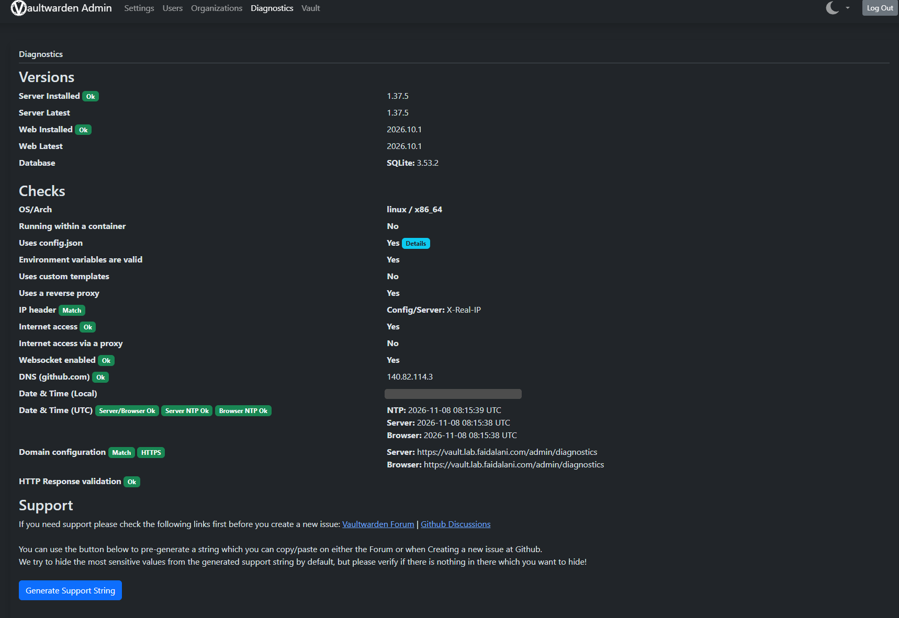

---

## What Vaultwarden is

Vaultwarden is a lightweight, unofficial server for **Bitwarden**, written in
Rust. I run the server; my phone, browser and PC use the normal, official
Bitwarden apps pointed at it instead of at bitwarden.com.

The key idea is **zero-knowledge encryption**:

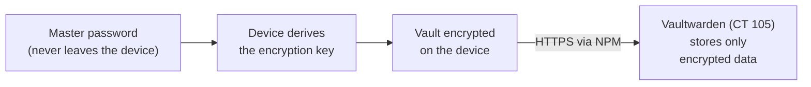

The server never sees a password in readable form. Someone who stole the
whole container would get encrypted data. That also means **there is no
"forgot master password"**: nobody can decrypt the vault without it, not even
me as the admin.

## Why it's worth running

| Benefit | What it means in practice |
|---|---|
| **Out of the browser** | Passwords no longer live inside Chrome, where any malware that reads the browser profile can try to grab them |
| **Same vault everywhere** | Phone app, browser extension and web vault stay in sync in seconds (WebSockets) |
| **I own the data** | The vault lives on my hardware, and backups are mine |
| **Real HTTPS, no port forwards** | Built on build 05's wildcard certificate; away from home it works over Tailscale |
| **Bitwarden's paid features** | Vaultwarden includes features Bitwarden charges for, like vault health reports and TOTP codes in the vault |
| **Password hygiene** | A generator and reports for reused and weak passwords |

**What this shows:** zero-knowledge encryption · secrets handling (hashing
an admin token with Argon2) · closing and *testing* self-registration · user
enumeration · TOTP 2FA and recovery codes · backup strategy (3-2-1) ·
debugging config precedence

---

## Goal

| Item | Value |
|---|---|
| Container | Unprivileged LXC, Debian 13 |
| CT ID / hostname | `105` / `vaultwarden` |
| Resources | 4 vCPU · 6 GB RAM to compile, then **2 vCPU · 1 GB** to run · 20 GB disk |
| Network | `vmbr0`, static **192.168.50.105/24**, gateway `192.168.50.1` |
| DNS server | `9.9.9.9` (Quad9) |
| App | Vaultwarden 1.37.5 · web vault 2026.10.1 · SQLite |
| Port | `8000`, HTTPS with a self-signed certificate (only NPM talks to it) |
| Public name | `https://vault.lab.faidalani.com` (via NPM, wildcard certificate) |
| Config | `/opt/vaultwarden/.env` |

---

## Part 1: Install

Same source as every build: the Proxmox VE Community Scripts project. The
script page shows the two choices this build starts with: **Debian** or
**Alpine**.

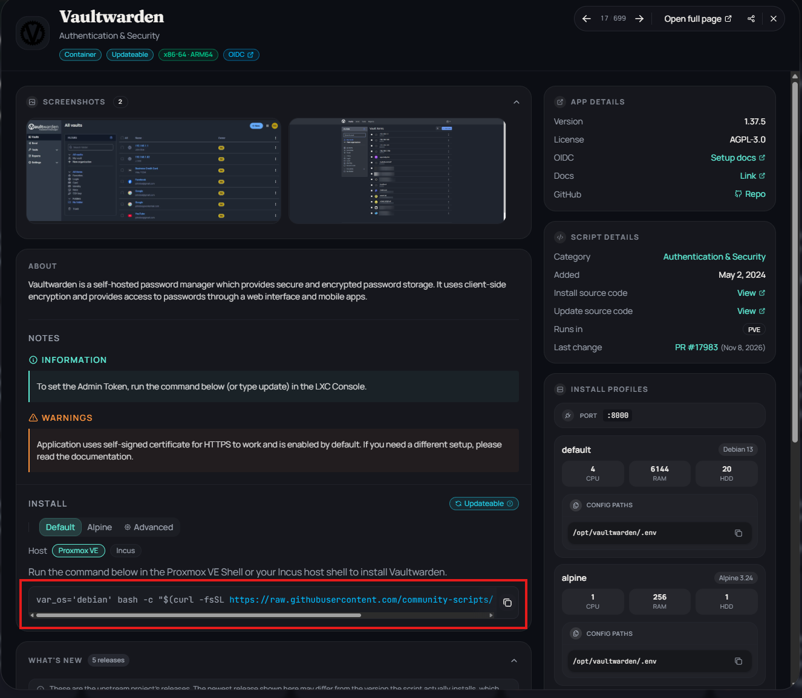

| | **Debian 13** (chosen) | Alpine |
|---|---|---|
| Resources | 4 CPU · 6 GB RAM · 20 GB | 1 CPU · 256 MB · 1 GB |
| How it installs | **Compiles** the latest Vaultwarden from source (Rust) | Installs a prebuilt package |
| Updates | Always the newest upstream release | Whatever Alpine packages, which can lag behind |

For a password manager, getting security fixes fast matters more than saving
RAM. The 6 GB is only needed while compiling, so I shrank it afterwards.

Run from the **Proxmox host shell** (the site's command pre-selects Debian):

```bash
var_os='debian' bash -c "$(curl -fsSL https://raw.githubusercontent.com/community-scripts/ProxmoxVE/main/ct/vaultwarden.sh)"
```

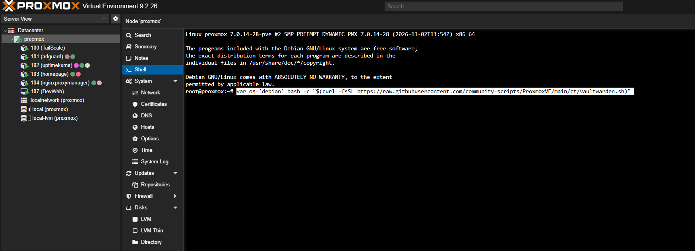

**Advanced Install** again. The wizard is the same as builds 02 to 05
([every choice explained](../03-uptime-kuma/#part-2-advanced-install-every-choice-explained)),
so only this build's choices are listed here:

| Setting | Value | Why |
|---|---|---|
| Container type | **Unprivileged** | Root in the container isn't root on the host |
| CT ID / IP | `105` / `192.168.50.105/24` | ID matches the last number of the IP |
| Disk / CPU / RAM | 20 GB / 4 / 6144 MB | Script defaults; the Rust compile needs them |
| Bridge | `vmbr0` | The home LAN. `vmbr1` to `vmbr4` are already created for Phase 3's segmented networks. |
| DNS server | `9.9.9.9` | Must work even if AdGuard is down |
| TUN/TAP, FUSE, GPU | No | Not needed |
| Nesting | Yes (default) | Lets Debian 13's systemd sandbox the service |
| Root SSH / SSH keys | No / none | Managed from the Proxmox console |
| Container protection | No *(turned on in Part 4)* | |
| APT cacher / HTTP proxy | No | No cache server or corporate proxy on this network |

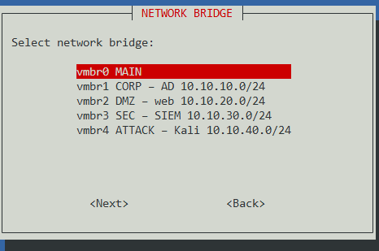
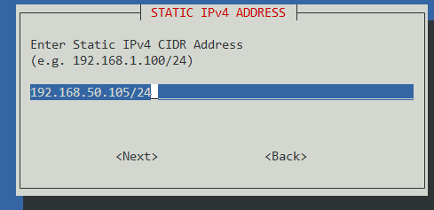
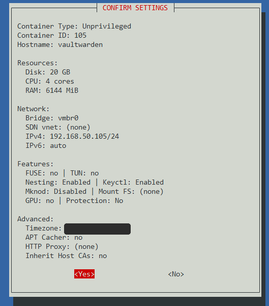

The build took about **10 minutes**: Rust 1.99.1, then Vaultwarden 1.37.5
compiled from source, then the web vault.

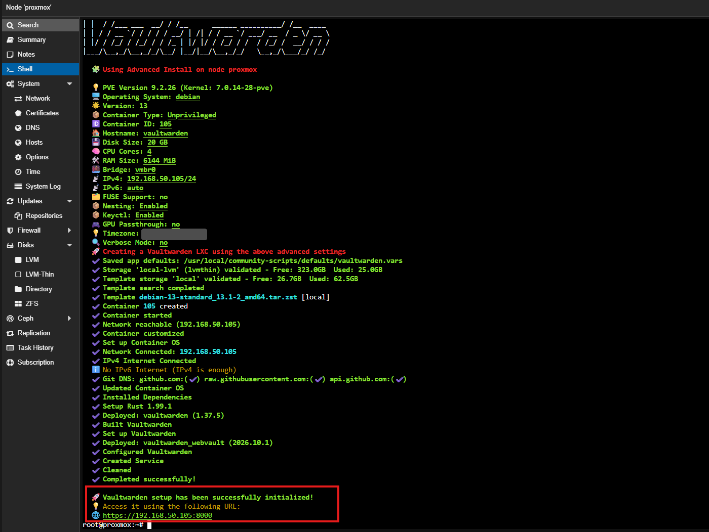

### Right-size it
The 6 GB was only for compiling. **CT 105 → Resources:** Memory `1024`
(swap `512`), Cores `2`. It applies live, no reboot.

> ⚠️ **Before running an update:** the update recompiles from source. Raise
> RAM back to 6144 first, or the build can run out of memory halfway.

---

## Part 2: A name and HTTPS

### Tell Vaultwarden its own address
In **CT 105 → Console**:

```bash
cat >> /opt/vaultwarden/.env <<'EOF'
DOMAIN=https://vault.lab.faidalani.com
SIGNUPS_ALLOWED=true
EOF
systemctl restart vaultwarden
```

- **`DOMAIN`**: Vaultwarden builds links, attachment downloads and passkey/2FA
  checks from it. Behind a proxy, some of those break without it.
- **`SIGNUPS_ALLOWED=true`**: already the default. Writing it out puts the
  switch in plain sight for Part 3.

Those two lines went in **twice**. See [Challenge 1](#1-the-console-pasted-my-commands-twice).

### Proxy host in NPM

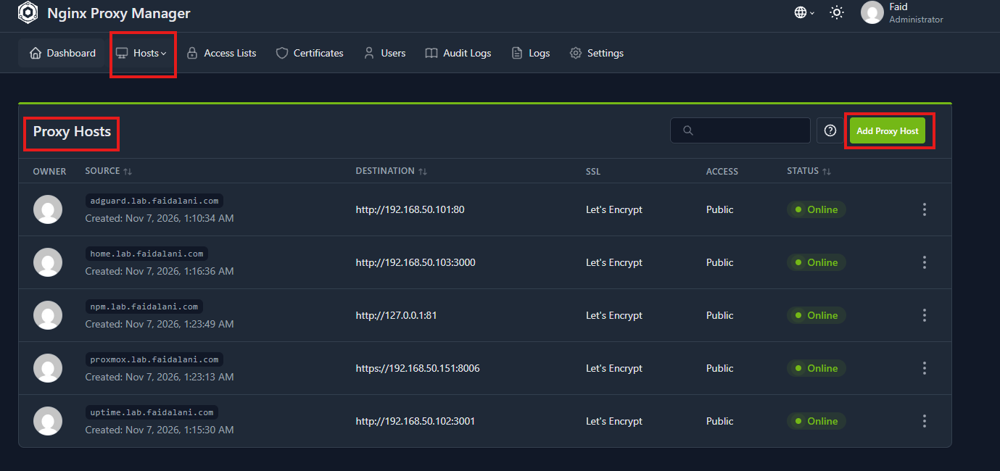

| Tab | Field | Value |
|---|---|---|
| Details | Domain | `vault.lab.faidalani.com` |
| | Scheme | **`https`** |
| | Forward to | `192.168.50.105` : `8000` |
| | Block Common Exploits / Websockets | On / **On** |
| SSL | Certificate | `*.lab.faidalani.com` |
| | Force SSL / HTTP/2 / HSTS | On / On / On |

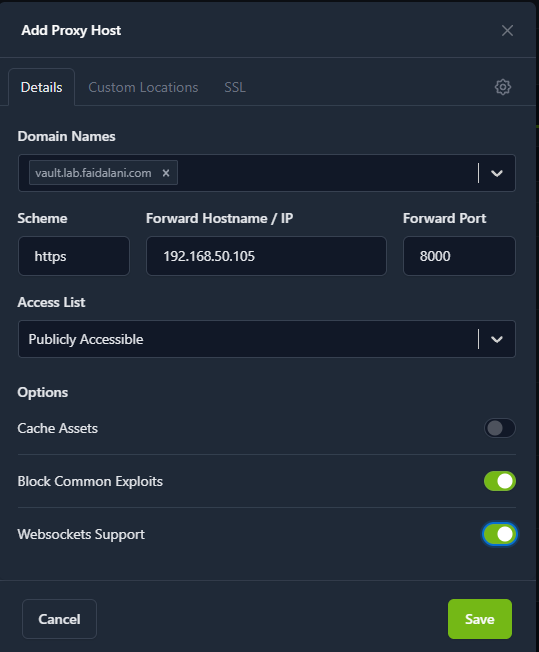
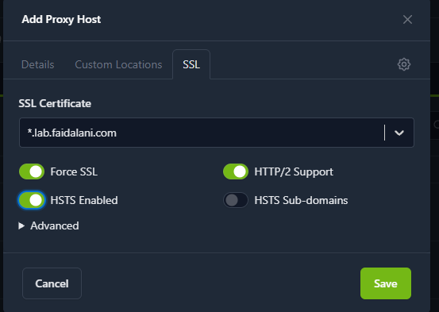

- **Scheme `https`**: the script sets Vaultwarden up to serve HTTPS only,
  with a self-signed certificate. That's the same situation as Proxmox in
  [build 05](../05-nginx-proxy-manager/#1-proxmox-redirected-you-too-many-times).
  This is the one service where the NPM-to-backend hop is encrypted too.
- **Websockets On**: this is how the apps get notified of changes right away
  instead of waiting for their next sync.
- **No new DNS record and no new certificate.** AdGuard's wildcard rewrite
  already sends `vault.lab` to NPM, and the wildcard certificate already
  covers it. Build 05 paid off here.

---

## Part 3: My account, then close the door

### Create the account
**Create account** → email + name → master password.


- **Master password:** a long passphrase. There's no recovery, so it's also
  written on paper and stored safely.
- **Password hint:** blank. The hint is stored unencrypted, so anything useful
  to me is useful to an attacker too.
- **"Check known data breaches"**: safe to leave on. The browser sends only
  the first 5 characters of the password's SHA-1 hash to Have I Been Pwned
  and compares the results locally (k-anonymity). The password never leaves
  the machine.
- No email verification: Vaultwarden only sends mail if an SMTP server is
  configured, and this one isn't (see [known gaps](#security-notes--known-gaps)).

### Turn sign-ups off

```bash
sed -i 's/^SIGNUPS_ALLOWED=.*/SIGNUPS_ALLOWED=false/' /opt/vaultwarden/.env
systemctl restart vaultwarden
grep SIGNUPS /opt/vaultwarden/.env
```

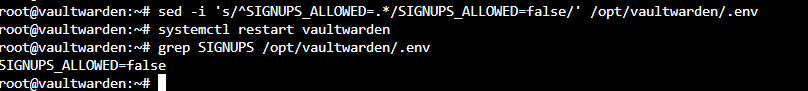

`sed` rewrites **every** matching line, so even a leftover duplicate would
have been fixed too.

### Test the control, don't assume it
Logged out, I tried to register a made-up account:

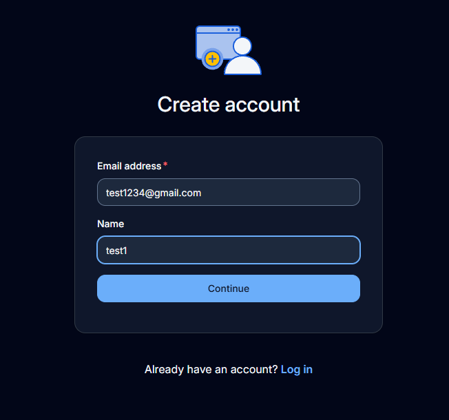
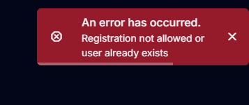

Refused. The wording is deliberately vague: *"not allowed **or** user already
exists."* If it said "that email already has an account," the sign-up form
would let anyone check which emails use my server. That's called **user
enumeration**.

---

## Part 4: Admin token, 2FA, protection

### A strong admin token, stored as a hash
The admin panel at `/admin` manages users and server settings. Its token
should be long and random.

1. **Tools → Generator:** 40 characters, letters and numbers only. Symbols
   were off on purpose: the token gets pasted into the Proxmox console, which
   can mangle symbols (and paste twice, see Challenge 1). 40 characters from
   62 letters and digits is about **238 bits** of randomness. Nobody is
   brute-forcing that.
2. Saved as a vault login item with the URI `https://vault.lab.faidalani.com/admin`,
   so the extension can fill it in.

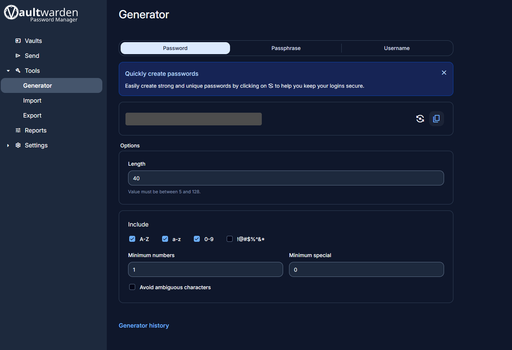

3. **CT 105 console → `update`.** It's a command typed in the console, not a
   Proxmox button (see Challenge 2). Answer `y` to the RAM warning, then pick
   **2 Set Admin Token** and paste.

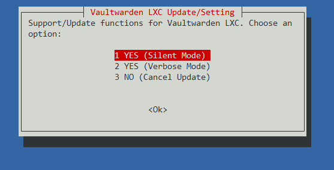
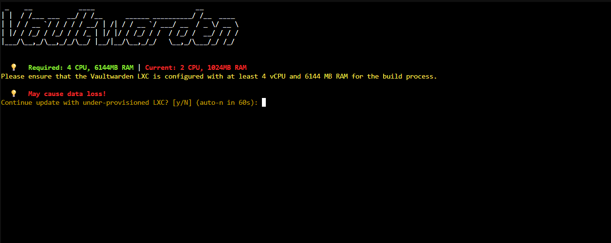

The script doesn't store the token. It stores an **Argon2 hash** of it:

```bash
grep ADMIN_TOKEN /opt/vaultwarden/.env | cut -c1-45
# ADMIN_TOKEN='$argon2i$v=19$m=65536,t=2,p=4$...
```

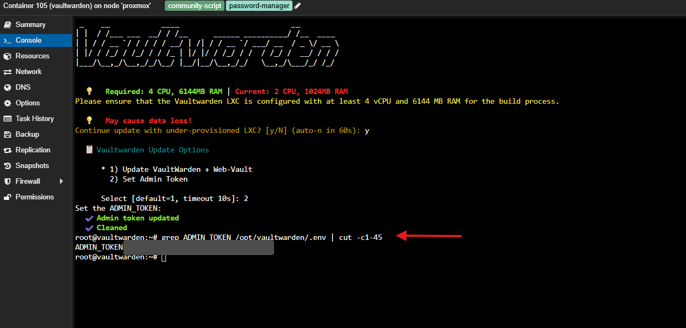

`m=65536` means every guess costs an attacker 64 MB of memory, and `t=2`
means two passes over it. It's the same idea as storing password hashes
instead of passwords: reading `.env` doesn't give you the token.

### Admin panel: look, don't save

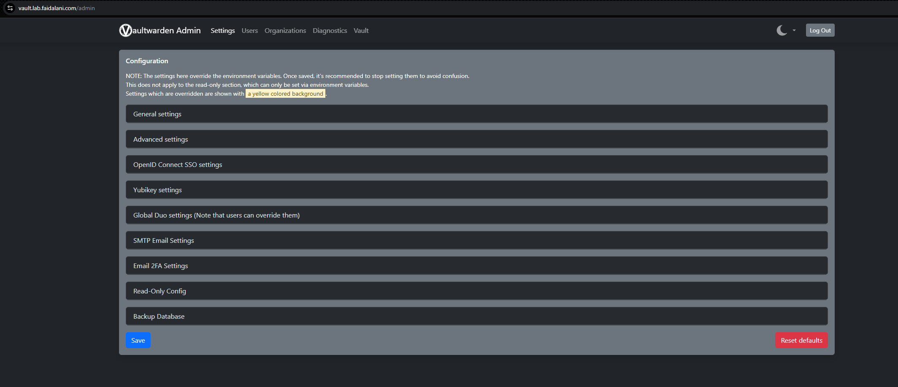

The page warns about it itself: clicking **Save** writes `data/config.json`,
which **overrides `.env`** from then on. See
[Challenge 3](#3-a-hidden-config-file-overriding-the-real-one).

**Diagnostics** is the health check, and everything came back green:
versions current, reverse proxy detected, **IP header `X-Real-IP` matches**
(so logs show real client IPs, which matters for Wazuh later), WebSockets on,
NTP in sync, and the domain matches over HTTPS.


### Two-step login (TOTP)
**Settings → Security → Two-step login → Authenticator app → Manage** →
confirm the master password → scan → enter a code → **Turn on**.

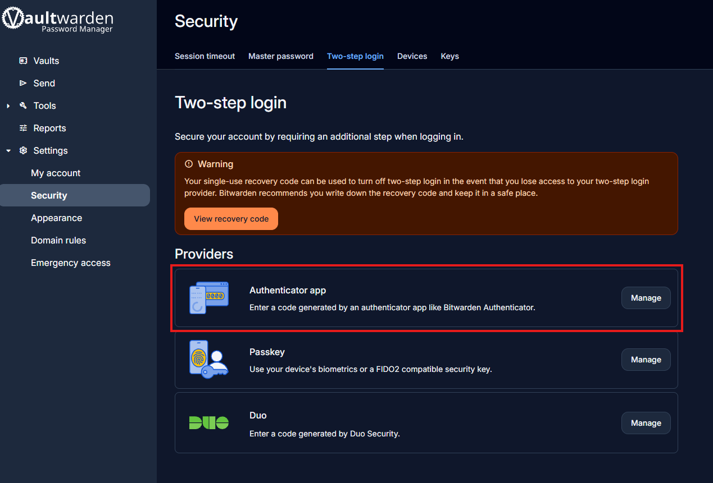
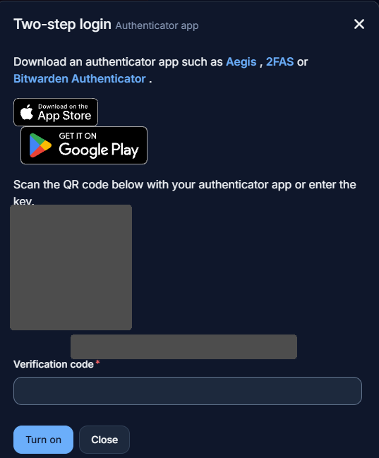

- An attacker who learns my master password still can't log in without my
  phone.
- The **recovery code** is written down **outside the vault**. If the phone
  is lost, that code is the way back in. A recovery code stored inside the
  vault it unlocks is useless.

### Container protection
**CT 105 → Options → Protection → Yes.** Proxmox now refuses to delete the
container until this is unticked. That's cheap insurance against a misclick.

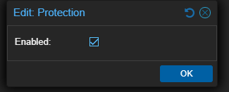

---

## Part 5: Phone and browser

The official Bitwarden apps, pointed at my server: on the login screen,
**Accessing: bitwarden.com → self-hosted →** `https://vault.lab.faidalani.com`.

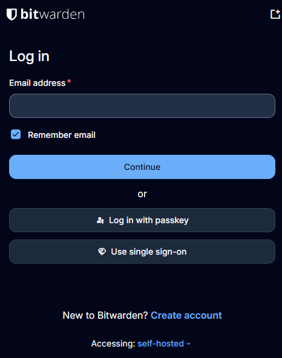
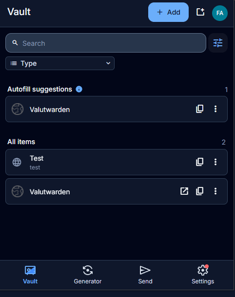

- **It works because the certificate is real.** Mobile apps reject
  self-signed certificates unless you install your own CA on the phone. The
  Let's Encrypt wildcard from build 05 avoids all of that.
- **Away from home: Tailscale on.** `vault.lab` only resolves on my LAN or
  through Tailscale split DNS. Without the tunnel, the app still opens the
  vault from its offline copy; new changes sync when it reconnects.
- **Sync test:** I added an item on one device and it appeared on the other
  within seconds. That's the WebSockets switch.

---

## Part 6: Moving off Chrome's password manager

| What | How it moves |
|---|---|
| **Passwords** | CSV export from Chrome → **Tools → Import → Chrome** |
| **Passkeys** (synced in Google Password Manager) | **Never in a CSV.** They move app-to-app on the phone with the FIDO Credential Exchange Protocol (CXP). |
| **Passkeys stored in Windows Hello** | Can't be exported. Re-create them in Bitwarden, one site at a time. |

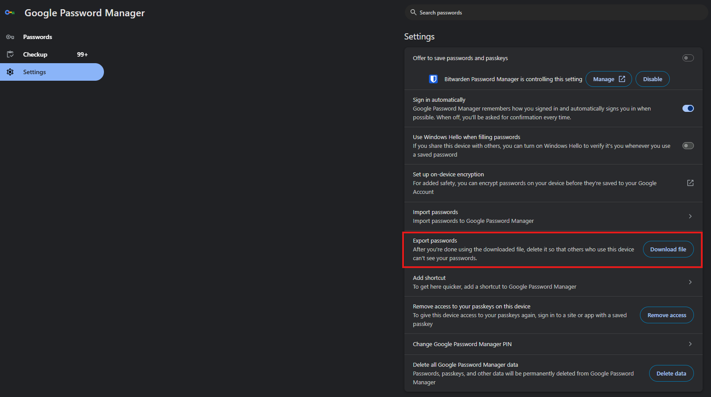
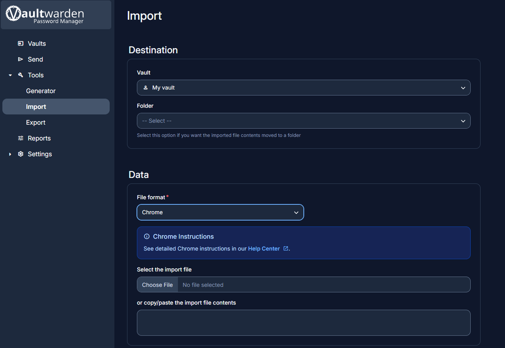

> ⚠️ The CSV holds every password in **plain text**. I deleted it right
> after the import and emptied the Recycle Bin.

**Passkeys need one server setting.** The Bitwarden mobile apps only show
the CXP import if the server enables a feature flag, and Vaultwarden leaves
it off by default:

```bash
echo 'EXPERIMENTAL_CLIENT_FEATURE_FLAGS=cxp-import-mobile' >> /opt/vaultwarden/.env
systemctl restart vaultwarden
```

Then log out of the phone app and back in, so it picks up the server's new
setting.

Once logins were working from Bitwarden, Chrome's own password saving went
off. The extension now controls that setting, as the Chrome screenshot shows.
I'm keeping the Google copy for a few days as a safety net before deleting it.

---

## Part 7: Backups (three layers)

All my passwords now live in one container, so this is the part that matters
most.

| Layer | What | Protects against |
|---|---|---|
| **1. Nightly container backup** | **Datacenter → Backup**: daily job for CTs 100–105, **snapshot** mode (no downtime), keeping 7 dailies and 4 weeklies | Breaking the container, a bad update, deleting data by mistake |
| **2. Encrypted export, off the server** | **Tools → Export → `.json (Encrypted)`, password protected**, with a password different from the master password, kept off the Proxmox box | The whole server or its disk dying. It imports into *any* Bitwarden server, including the official cloud. |
| **3. Restore test** | Restore a backup as a new CT with its network disconnected, check `/opt/vaultwarden/data`, then delete it | Finding out a backup doesn't work *when you need it* |

Layer 1 alone isn't enough: it sits on the same disk as Proxmox. The
**3-2-1 rule** (3 copies, 2 different media, 1 off-site) is why layer 2
exists. Layer 3 is scheduled; a backup that has never been restored is a
guess.

---

## Part 8: Wire it into the lab

**Homepage**: tile in Lab Core. The click goes to the HTTPS name; the health
check pings the IP (Homepage can't resolve lab names, and monitoring
shouldn't depend on NPM):

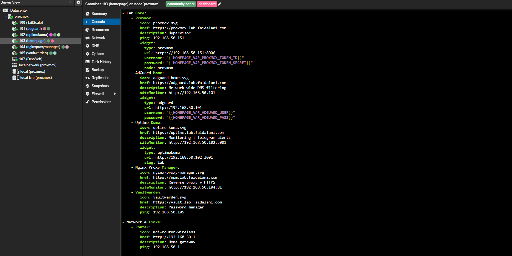

```yaml
- Vaultwarden:
    icon: vaultwarden.svg
    href: https://vault.lab.faidalani.com
    description: Password manager
    ping: 192.168.50.105
```

**Uptime Kuma**: HTTP(s) monitor on `https://192.168.50.105:8000/alive`
(Vaultwarden's built-in health page) with **Ignore TLS/SSL errors** on,
because the backend certificate is self-signed. Added to the `lab` status
page.

**Start order**: CT 105 → Options → Start/Shutdown order `4`, after DNS,
Tailscale and NPM.

---

## Final `.env`

```bash
ADMIN_TOKEN='$argon2i$v=19$m=65536,t=2,p=4$...'   # Argon2 hash, not the token
ROCKET_ADDRESS=0.0.0.0
ROCKET_TLS='{certs="/opt/vaultwarden/ssl-cert-snakeoil.pem",key="/opt/vaultwarden/ssl-cert-snakeoil.key"}'
DATA_FOLDER=/opt/vaultwarden/data
DATABASE_MAX_CONNS=10
WEB_VAULT_FOLDER=/opt/vaultwarden/web-vault
WEB_VAULT_ENABLED=true
DOMAIN=https://vault.lab.faidalani.com
SIGNUPS_ALLOWED=false
EXPERIMENTAL_CLIENT_FEATURE_FLAGS=cxp-import-mobile
```

Each line appears **once**. A copy is in [`config/vaultwarden.env.example`](config/vaultwarden.env.example).

---

## Challenges & Fixes

### 1. The console pasted my commands twice

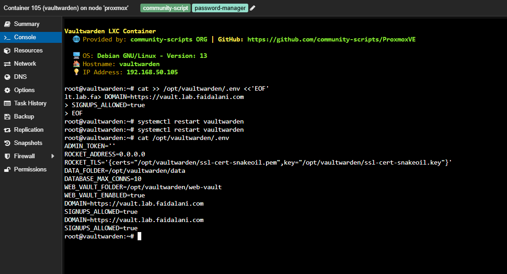

After appending two lines to `.env`, `cat` showed both lines **twice**. The
Proxmox web console had pasted the block two times. It happened again later
with the feature flag:

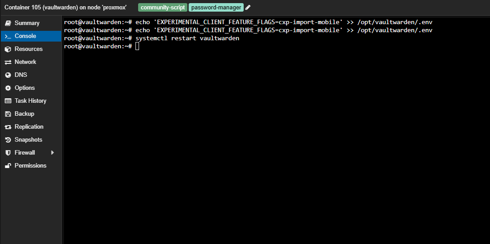

With identical values it does no harm *today*. The danger is later: when a
setting appears twice, **the last one wins**. If I had flipped only the first
`SIGNUPS_ALLOWED` to `false`, the second `true` would have quietly won, and
sign-ups would have stayed open on my password manager.

**Fix:** keep the first copy of every line, then restart:

```bash
awk '!seen[$0]++' /opt/vaultwarden/.env > /tmp/env && cat /tmp/env > /opt/vaultwarden/.env && rm /tmp/env
systemctl restart vaultwarden
```

`cat > file` rewrites the existing file, so its owner and permissions stay
the same. **Habit now:** after pasting anything into the console, read the
file back before moving on.

### 2. `update` isn't a button, and its menu has a 10-second default
The script page says to "type update" in the console. I first looked for an
**Update** entry in the Proxmox menu; it's a command inside the container.

The menu then has two traps:
- An **under-provisioned warning** ("May cause data loss!") because the
  container has 1 GB instead of 6 GB. That warning is about the rebuild, so
  for setting a token, answering `y` is safe.
- The options menu says **`default=1, timeout 10s`**. Option 1 is the full
  recompile. Hesitate for 10 seconds and it starts compiling with 1 GB of
  RAM: exactly the data-loss case it warned about.

**Fix:** know your answer before opening the menu. For real updates, raise
RAM to 6 GB first.

### 3. A hidden config file overriding the real one
Diagnostics reported **"Uses config.json: Yes."** Clicking **Save** in the
admin settings writes `data/config.json`, and from then on its values win
over `.env`. That leaves two places for settings, and the hidden one takes
precedence. A later `.env` change, like the feature flag, would have been
silently ignored.

**Fix:** moved it aside (not deleted) so `.env` is the single place for
settings again:

```bash
mv /opt/vaultwarden/data/config.json /root/config.json.bak
systemctl restart vaultwarden
```

Rule for this lab: **settings live in `.env`; the admin panel is for
looking.**

### 4. Duplicates after the import
The vault filled up with duplicate logins. Bitwarden's import **never
merges**: every import adds new copies, and Chrome's export had duplicates
of its own.

**Fix:**
- Sort by name and bulk-delete the extras (select → ⋮ → Delete).
- **Reports → Reused passwords** groups duplicates, because copies share a
  password.
- Where two copies existed, I kept the one holding a **passkey**.
- Deleted items sit in Trash; Vaultwarden doesn't auto-empty it, so mistakes
  can be undone.

**Rule:** one import per file.

### 5. A red marker isn't redaction
My first generator screenshot had a red line over the password, but bits of
the characters still showed above and below it. Once any part of a secret is
in a screenshot, treat it as used: I **regenerated** it before using it as
the token. The 2FA setup screenshot had the same issue with its key text.
Every secret in this write-up is covered with a **solid** bar.

---

## Security notes & known gaps

| Done | Detail |
|---|---|
| ✅ Zero-knowledge vault | Encrypted on each device; the server stores only encrypted data |
| ✅ HTTPS end to end | Real certificate at NPM; the NPM → Vaultwarden hop is TLS too |
| ✅ No inbound ports | Reachable only on the LAN and through Tailscale |
| ✅ Sign-ups closed and **tested** | The refusal message doesn't reveal which emails have accounts |
| ✅ Admin token | 40 random characters, stored as an Argon2 hash |
| ✅ 2FA | TOTP, with the recovery code stored offline |
| ✅ Container | Unprivileged, protected from deletion, starts at boot |
| ✅ Backups | Nightly snapshot backups plus an encrypted export kept off the server |

| Known gap | Plan |
|---|---|
| **`/admin` is reachable from anywhere on the LAN** | Restrict it with an NPM access list (or disable it when not in use). Later, OPNsense rules. |
| **No SMTP** | No new-device login emails, no invites. Add an SMTP relay later. |
| **Restore not yet tested** | Layer 3 above. |
| **Backups share the Proxmox disk** | The encrypted export covers it for now; an off-box backup target comes later. |
| **Failed logins aren't monitored** | Vaultwarden logs failed logins with the real client IP (`X-Real-IP`). Phase 5 sends them to Wazuh. |
| **Updates are manual and need 6 GB of RAM** | Check the Diagnostics page for new versions; raise RAM, then `update`. |
| **Google sign-in (SSO) not set up** | Vaultwarden supports OpenID Connect, but the master password is still required to unlock the vault. Optional add-on. |

---

## Lessons learned

1. **Zero-knowledge has a cost.** No one can reset the master password. Paper
   backup plus a recovery code is the plan, not an afterthought.
2. **Test the control, don't assume it.** Closing sign-ups took one line;
   *proving* it took one failed registration.
3. **Store hashes, not secrets.** The admin token lives in `.env` as an
   Argon2 hash.
4. **Know which config wins.** `.env`, `config.json`, duplicate lines: the
   last or hidden value takes precedence. Keep one source of truth and read
   files back after editing.
5. **Default answers matter.** A 10-second default that starts a rebuild is
   a trap. Read menus before opening them.
6. **Backups are layers.** Same-disk snapshots, an off-box encrypted export,
   and a restore test, because each covers a failure the others don't.
7. **Treat a partly visible secret as exposed.** Regenerate it and cover it
   with solid bars.

---

*Screenshots are redacted per the lab's [documentation rules](../README.md#how-i-document):
the timezone, the 2FA QR code and key, the generated token and the token
hash are covered with solid bars. Image metadata is stripped.*

**Phase 2 (secure access) is complete.** *Next: Phase 3, OPNsense and the
segmented lab networks (CORP, DMZ, SEC, ATTACK).*
