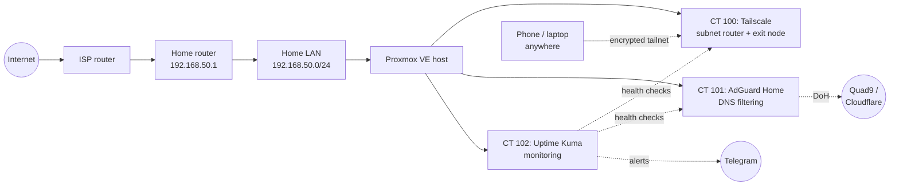

# Home SOC Lab (Proxmox)

I'm building a small, segmented "company network" at home on Proxmox VE so I
can practice what a SOC analyst does every shift: build it, attack it, and
watch the logs. This repo is the full build log, one folder per component,
with every step, screenshot and the problems I hit along the way.

**Author:** Faid Al-Ani · CompTIA Security+, CySA+ ·
[faidalani.com](https://faidalani.com) ·
[LinkedIn](https://www.linkedin.com/in/faid-alani)

---

## Lab at a glance

| | |
|---|---|
| Hypervisor | Proxmox VE 9.2 |
| Host | Intel i7-10700K (8c/16t), 32 GB RAM |
| Home LAN | `192.168.50.0/24` (core service containers live here) |
| Remote access | Tailscale subnet router + exit node, **zero inbound ports** |
| DNS | AdGuard Home: network-wide filtering, encrypted (DoH) upstreams |
| Monitoring | Uptime Kuma: health checks on every service, Telegram alerts |

---

## Build log

### Phase 1: Core services (home LAN)

| # | Component | What it does | Status |
|---|---|---|---|
| 01 | [Tailscale](01-tailscale/) | Remote access to the whole lab with no open ports | ✅ Done |
| 02 | [AdGuard Home](02-adguard-home/) | Network-wide DNS + ad/tracker blocking | ✅ Done |
| 03 | [Uptime Kuma](03-uptime-kuma/) | Service monitoring + phone alerts | ✅ Done |
| 04 | Homepage | Single dashboard for every service | 🔜 Next |

### Later phases (planned)

- **OPNsense firewall** segmenting the lab into separate networks: CORP
  (Active Directory), DMZ (public website), SEC (SIEM) and ATTACK (Kali)
- **Wazuh SIEM** with endpoint agents and the MITRE ATT&CK dashboard
- **Active Directory**: Windows Server DC, two clients, OUs, GPOs,
  admin/user/guest accounts
- **Kali Linux** attack simulation, with detections tracked in Wazuh
- **Nginx Proxy Manager + Vaultwarden** for internal HTTPS and a self-hosted
  password manager

---

## How I document

- **Every step has a screenshot.** Someone should be able to rebuild it from
  this repo alone.
- **Each write-up has a "Challenges & Fixes" section.** The errors I hit and
  how I solved them are usually more useful than the clean steps.
- **Screenshots are redacted** before they're committed: account emails and
  tailnet names, Tailscale (100.x) addresses, one-time auth links, personal
  device names and their IPs, MAC addresses and the IPv6 addresses derived
  from them, SSH host fingerprints, and anything tied to location. The lab's
  own `192.168.50.x` addresses are left visible because a reader needs them
  to follow along. They're private (RFC 1918) and not reachable from the
  internet. Image metadata is stripped.
- **No secrets in the repo.** Config files are committed with placeholders
  (`.env.example`), never real credentials.
